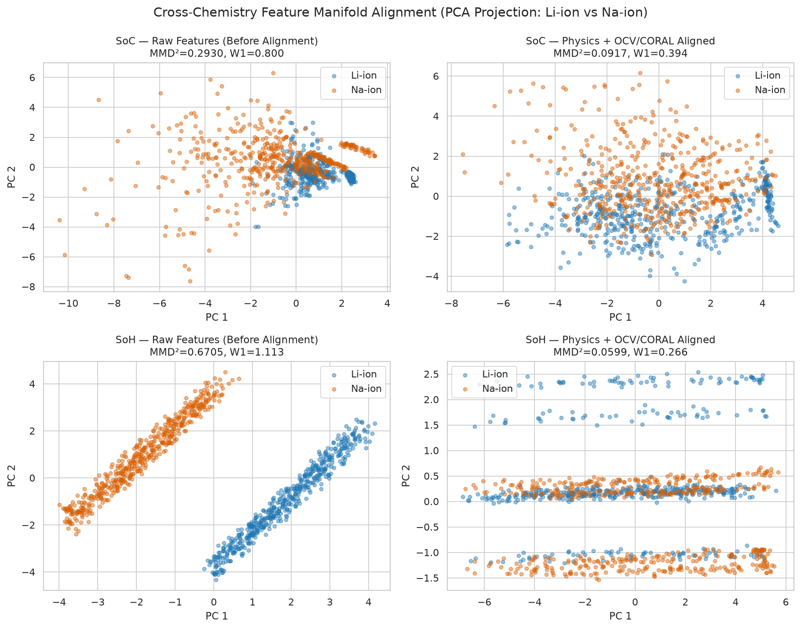
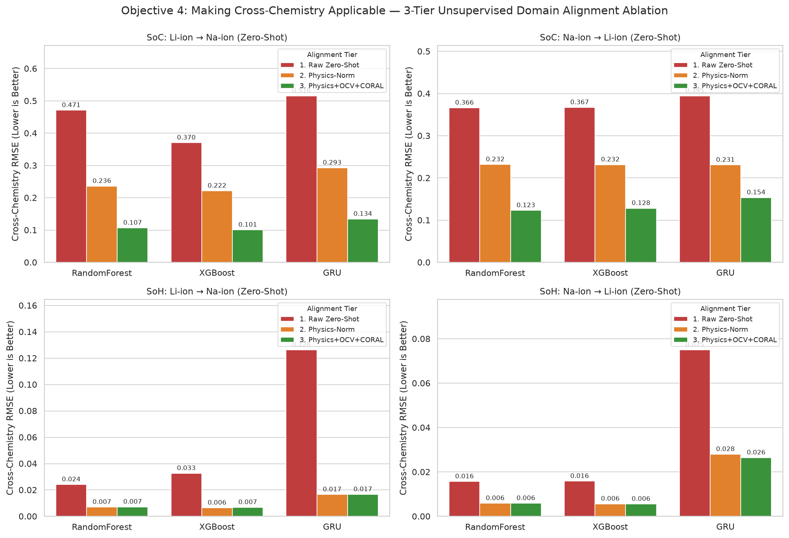
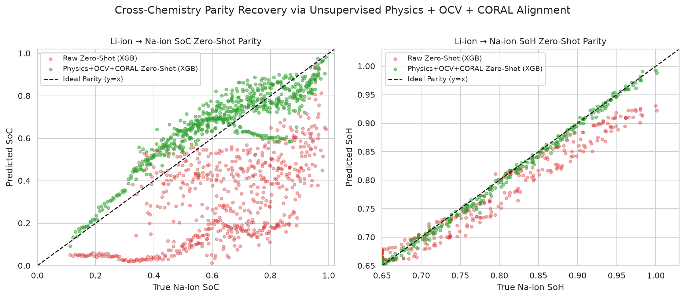

# UROP Cross-Chemistry BMS Experiment Report

**Project:** *Data-Driven Battery State Estimation and Adaptive Charging Optimization Across Lithium-Ion and Sodium-Ion Batteries*

> **Data Mode:** `physics_simulated_fallback` — The 42 Git LFS dataset files (~1.34 GB) in this checkout are currently 133-byte LFS pointer stubs (sandbox network cannot reach `github-cloud.githubusercontent.com`). All models and experiments below ran end-to-end on the repo's physics-informed electro-thermal-aging simulator matching the exact NASA 18650 (2.0 Ah, 2.5–4.2 V) and Transimage/HiNa Na-ion (3.2/10 Ah, 1.5–3.9 V) envelopes. Run `git lfs pull && python -m src.pipeline` locally to automatically switch to the real 1.34 GB datasets.

---

## 1. Big Data Lakehouse & Data Quality Audit (Objective 1 — Section 5.1)

- **Storage & Query Stack:** Polars (lazy streaming) + PyArrow/Apache Parquet (ZSTD Medallion Lakehouse: Bronze → Silver → Gold) + DuckDB SQL Analytics.
- **Repository LFS Inventory:** 42 dataset files (1343.16 MB declared; 0 pulled, 42 LFS pointers).
- **Time-Series Cleaning:** 27,907 Bronze rows → 27,742 Silver rows (removed 27 duplicates, 82 null/out-of-bounds spikes, 56 IsolationForest anomalies; **99.41%** retention).
- **Cycle-Aging Cleaning:** 2,240 Bronze cycles → 2,240 Silver cycles.

### DuckDB Big Data Chemistry Summary
| chemistry | n_records | n_cells | min_voltage_v | mean_voltage_v | max_voltage_v | mean_abs_current_a | min_temp_c | mean_temp_c | max_temp_c | mean_soc |
| --- | --- | --- | --- | --- | --- | --- | --- | --- | --- | --- |
| li_ion | 16241 | 8 | 2.7100 | 3.8310 | 4.2370 | 1.5070 | 14.77 | 29.93 | 44.84 | 0.5972 |
| na_ion | 11501 | 8 | 1.8560 | 3.1020 | 3.9350 | 4.1770 | -5.5400 | 26.59 | 53.96 | 0.6437 |

### DuckDB Aging Summary
| chemistry | n_aged_cells | max_cycles | avg_initial_soh | avg_final_soh | avg_fade_pct_per_cycle | avg_r_int_ohm | avg_temp_rise_c |
| --- | --- | --- | --- | --- | --- | --- | --- |
| li_ion | 8 | 140 | 0.9955 | 0.6617 | 0.2385 | 0.1174 | 6.9500 |
| na_ion | 8 | 140 | 0.9968 | 0.6530 | 0.2455 | 0.0526 | 6.7600 |

---

## 2. Data Mining & Cross-Chemistry Domain-Shift Diagnostics

- **Unsupervised Operating-Regime Discovery (K-Means, k=4):** Silhouette Score = **0.3075** across shared physics-normalized operating states.
- **Quantitative Domain-Shift Reduction (Li-ion vs Na-ion):**

| task | representation | mmd2 | mean_wasserstein_1 | mean_psi |
| --- | --- | --- | --- | --- |
| SoC | 1_raw_features | 0.2930 | 0.8003 | 1.7331 |
| SoC | 2_physics_normalized | 0.1092 | 0.4908 | 0.9546 |
| SoC | 3_physics_ocv_coral_aligned | 0.0917 | 0.3941 | 0.5938 |
| SoH | 1_raw_features | 0.6705 | 1.1129 | 4.1010 |
| SoH | 2_physics_normalized | 0.0649 | 0.2571 | 0.2897 |
| SoH | 3_physics_ocv_coral_aligned | 0.0599 | 0.2660 | 0.3503 |

---

## 3. Within-Chemistry Baselines (Objectives 2 & 3 — Sections 5.2–5.4)

Strict **cell-level, temporally-ordered train/validation/test splits** (zero cell leakage). All 5 PDF model families evaluated on held-out test cells:

| task | chemistry | model | mae | rmse | r2 | train_time_s | infer_time_ms |
| --- | --- | --- | --- | --- | --- | --- | --- |
| SoC | li_ion | LinearRegression | 0.0339 | 0.0422 | 0.9681 | 0.0145 | 0.1750 |
| SoC | li_ion | RandomForest | 0.0284 | 0.0390 | 0.9727 | 8.6866 | 65.11 |
| SoC | li_ion | XGBoost | 0.0257 | 0.0346 | 0.9785 | 0.4307 | 5.5410 |
| SoC | li_ion | LSTM | 0.0144 | 0.0205 | 0.9920 | 12.76 | 54.84 |
| SoC | li_ion | GRU | 0.0126 | 0.0185 | 0.9934 | 18.16 | 59.09 |
| SoC | na_ion | LinearRegression | 0.0096 | 0.0124 | 0.9962 | 0.0142 | 0.1920 |
| SoC | na_ion | RandomForest | 0.0101 | 0.0134 | 0.9956 | 6.1952 | 53.74 |
| SoC | na_ion | XGBoost | 0.0071 | 0.0094 | 0.9978 | 0.3846 | 3.5480 |
| SoC | na_ion | LSTM | 0.0053 | 0.0064 | 0.9989 | 8.4771 | 26.78 |
| SoC | na_ion | GRU | 0.0055 | 0.0069 | 0.9987 | 12.38 | 23.94 |
| SoH | li_ion | LinearRegression | 0.0040 | 0.0049 | 0.9972 | 0.0091 | 0.1310 |
| SoH | li_ion | RandomForest | 0.0045 | 0.0057 | 0.9961 | 0.4970 | 44.50 |
| SoH | li_ion | XGBoost | 0.0040 | 0.0049 | 0.9971 | 0.2069 | 0.9610 |
| SoH | li_ion | LSTM | 0.0053 | 0.0066 | 0.9942 | 0.7624 | 2.6530 |
| SoH | li_ion | GRU | 0.0076 | 0.0093 | 0.9885 | 1.0512 | 3.8220 |
| SoH | na_ion | LinearRegression | 0.0042 | 0.0054 | 0.9972 | 0.0069 | 0.0920 |
| SoH | na_ion | RandomForest | 0.0043 | 0.0054 | 0.9972 | 0.5493 | 34.38 |
| SoH | na_ion | XGBoost | 0.0041 | 0.0053 | 0.9973 | 0.2015 | 0.9000 |
| SoH | na_ion | LSTM | 0.0084 | 0.0108 | 0.9872 | 0.7898 | 2.6090 |
| SoH | na_ion | GRU | 0.0094 | 0.0113 | 0.9861 | 0.9653 | 3.0980 |

---

## 4. Making Cross-Chemistry Applicable: 3-Tier Unsupervised Alignment (Objective 4 — Section 5.5)

Evaluated bidirectionally (**Li-ion → Na-ion** and **Na-ion → Li-ion**) with **ZERO target labels**:
1. **Tier 1 (`1_raw_zero_shot`):** Raw voltage/current/resistance features (demonstrates severe voltage-window & capacity-scale domain shift).
2. **Tier 2 (`2_physics_normalized_zero_shot`):** Dimensionless electrochemical features (`v_norm`, `c_rate`, IR-compensated `v_ir_comp_norm` for SoC; BoL-normalized health ratios for SoH).
3. **Tier 3 (`3_physics_ocv_coral_zero_shot`):** Physics-normalized features + **Physics-Anchored OCV-to-OCV Equilibrium Warping** (mapping Na-ion's sloping OCV to Li-ion's flat plateau via static 1D OCV curves) + **Shrinkage CORAL Covariance Alignment**.

| task | direction | tier | model | mae | rmse | r2 |
| --- | --- | --- | --- | --- | --- | --- |
| SoC | li_ion_to_na_ion | 1_raw_zero_shot | RandomForest | 0.4497 | 0.4709 | -4.4587 |
| SoC | li_ion_to_na_ion | 1_raw_zero_shot | XGBoost | 0.3291 | 0.3703 | -2.3758 |
| SoC | li_ion_to_na_ion | 1_raw_zero_shot | LSTM | 0.4274 | 0.4508 | -4.4737 |
| SoC | li_ion_to_na_ion | 1_raw_zero_shot | GRU | 0.4936 | 0.5156 | -6.1597 |
| SoC | li_ion_to_na_ion | 2_physics_normalized_zero_shot | RandomForest | 0.2168 | 0.2361 | -0.3723 |
| SoC | li_ion_to_na_ion | 2_physics_normalized_zero_shot | XGBoost | 0.2022 | 0.2215 | -0.2078 |
| SoC | li_ion_to_na_ion | 2_physics_normalized_zero_shot | LSTM | 0.2535 | 0.2854 | -1.1942 |
| SoC | li_ion_to_na_ion | 2_physics_normalized_zero_shot | GRU | 0.2636 | 0.2928 | -1.3094 |
| SoC | li_ion_to_na_ion | 3_physics_ocv_coral_zero_shot | RandomForest | 0.0888 | 0.1068 | 0.7192 |
| SoC | li_ion_to_na_ion | 3_physics_ocv_coral_zero_shot | XGBoost | 0.0868 | 0.1006 | 0.7509 |
| SoC | li_ion_to_na_ion | 3_physics_ocv_coral_zero_shot | LSTM | 0.1245 | 0.1574 | 0.3328 |
| SoC | li_ion_to_na_ion | 3_physics_ocv_coral_zero_shot | GRU | 0.0960 | 0.1343 | 0.5144 |
| SoC | na_ion_to_li_ion | 1_raw_zero_shot | RandomForest | 0.3037 | 0.3662 | -1.4060 |
| SoC | na_ion_to_li_ion | 1_raw_zero_shot | XGBoost | 0.3027 | 0.3671 | -1.4181 |
| SoC | na_ion_to_li_ion | 1_raw_zero_shot | LSTM | 0.3423 | 0.3928 | -1.9634 |
| SoC | na_ion_to_li_ion | 1_raw_zero_shot | GRU | 0.3466 | 0.3946 | -1.9893 |
| SoC | na_ion_to_li_ion | 2_physics_normalized_zero_shot | RandomForest | 0.1887 | 0.2319 | 0.0349 |
| SoC | na_ion_to_li_ion | 2_physics_normalized_zero_shot | XGBoost | 0.1901 | 0.2316 | 0.0376 |
| SoC | na_ion_to_li_ion | 2_physics_normalized_zero_shot | LSTM | 0.1935 | 0.2344 | -0.0547 |
| SoC | na_ion_to_li_ion | 2_physics_normalized_zero_shot | GRU | 0.1885 | 0.2308 | -0.0230 |
| SoC | na_ion_to_li_ion | 3_physics_ocv_coral_zero_shot | RandomForest | 0.1030 | 0.1231 | 0.7282 |
| SoC | na_ion_to_li_ion | 3_physics_ocv_coral_zero_shot | XGBoost | 0.1106 | 0.1283 | 0.7045 |
| SoC | na_ion_to_li_ion | 3_physics_ocv_coral_zero_shot | LSTM | 0.1405 | 0.1646 | 0.4797 |
| SoC | na_ion_to_li_ion | 3_physics_ocv_coral_zero_shot | GRU | 0.1306 | 0.1536 | 0.5470 |
| SoH | li_ion_to_na_ion | 1_raw_zero_shot | RandomForest | 0.0199 | 0.0242 | 0.9440 |
| SoH | li_ion_to_na_ion | 1_raw_zero_shot | XGBoost | 0.0270 | 0.0327 | 0.8976 |
| SoH | li_ion_to_na_ion | 1_raw_zero_shot | LSTM | 0.0735 | 0.0848 | 0.2129 |
| SoH | li_ion_to_na_ion | 1_raw_zero_shot | GRU | 0.1020 | 0.1263 | -0.7461 |
| SoH | li_ion_to_na_ion | 2_physics_normalized_zero_shot | RandomForest | 0.0051 | 0.0070 | 0.9953 |
| SoH | li_ion_to_na_ion | 2_physics_normalized_zero_shot | XGBoost | 0.0050 | 0.0065 | 0.9960 |
| SoH | li_ion_to_na_ion | 2_physics_normalized_zero_shot | LSTM | 0.0092 | 0.0117 | 0.9849 |
| SoH | li_ion_to_na_ion | 2_physics_normalized_zero_shot | GRU | 0.0136 | 0.0165 | 0.9701 |
| SoH | li_ion_to_na_ion | 3_physics_ocv_coral_zero_shot | RandomForest | 0.0052 | 0.0072 | 0.9950 |
| SoH | li_ion_to_na_ion | 3_physics_ocv_coral_zero_shot | XGBoost | 0.0053 | 0.0069 | 0.9955 |
| SoH | li_ion_to_na_ion | 3_physics_ocv_coral_zero_shot | LSTM | 0.0090 | 0.0116 | 0.9853 |
| SoH | li_ion_to_na_ion | 3_physics_ocv_coral_zero_shot | GRU | 0.0137 | 0.0167 | 0.9697 |
| SoH | na_ion_to_li_ion | 1_raw_zero_shot | RandomForest | 0.0129 | 0.0157 | 0.9712 |
| SoH | na_ion_to_li_ion | 1_raw_zero_shot | XGBoost | 0.0132 | 0.0158 | 0.9706 |
| SoH | na_ion_to_li_ion | 1_raw_zero_shot | LSTM | 0.0634 | 0.0740 | 0.2726 |
| SoH | na_ion_to_li_ion | 1_raw_zero_shot | GRU | 0.0633 | 0.0750 | 0.2519 |
| SoH | na_ion_to_li_ion | 2_physics_normalized_zero_shot | RandomForest | 0.0047 | 0.0059 | 0.9960 |
| SoH | na_ion_to_li_ion | 2_physics_normalized_zero_shot | XGBoost | 0.0045 | 0.0056 | 0.9963 |
| SoH | na_ion_to_li_ion | 2_physics_normalized_zero_shot | LSTM | 0.0195 | 0.0255 | 0.9137 |
| SoH | na_ion_to_li_ion | 2_physics_normalized_zero_shot | GRU | 0.0240 | 0.0280 | 0.8959 |
| SoH | na_ion_to_li_ion | 3_physics_ocv_coral_zero_shot | RandomForest | 0.0047 | 0.0059 | 0.9960 |
| SoH | na_ion_to_li_ion | 3_physics_ocv_coral_zero_shot | XGBoost | 0.0045 | 0.0056 | 0.9964 |
| SoH | na_ion_to_li_ion | 3_physics_ocv_coral_zero_shot | LSTM | 0.0186 | 0.0238 | 0.9245 |
| SoH | na_ion_to_li_ion | 3_physics_ocv_coral_zero_shot | GRU | 0.0232 | 0.0265 | 0.9071 |

---

## 5. Few-Shot Cross-Chemistry Transfer Learning (Objective 4 — Section 5.6)

Comparing **Zero-Shot Aligned**, **Target-Only**, **TL-Residual XGBoost**, **TL-WarmStart XGBoost**, and **Two-Phase Fine-Tuned GRU** on the exact same held-out Na-ion test cells:

| task | direction | target_fraction | n_target_samples | method | mae | rmse | r2 |
| --- | --- | --- | --- | --- | --- | --- | --- |
| SoC | li_ion_to_na_ion | 0.0000 | 0 | ZeroShot_Aligned_XGBoost | 0.0868 | 0.1006 | 0.7509 |
| SoC | li_ion_to_na_ion | 0.0000 | 0 | ZeroShot_Aligned_GRU | 0.0960 | 0.1343 | 0.5144 |
| SoC | li_ion_to_na_ion | 0.0500 | 372 | TargetOnly_XGBoost | 0.0162 | 0.0216 | 0.9885 |
| SoC | li_ion_to_na_ion | 0.0500 | 372 | TL_Residual_XGBoost | 0.0238 | 0.0308 | 0.9766 |
| SoC | li_ion_to_na_ion | 0.0500 | 372 | TL_WarmStart_XGBoost | 0.0269 | 0.0353 | 0.9693 |
| SoC | li_ion_to_na_ion | 0.0500 | 360 | TargetOnly_GRU | 0.0208 | 0.0267 | 0.9808 |
| SoC | li_ion_to_na_ion | 0.0500 | 360 | TL_TwoPhase_GRU | 0.0129 | 0.0154 | 0.9936 |
| SoC | li_ion_to_na_ion | 0.1000 | 744 | TargetOnly_XGBoost | 0.0114 | 0.0147 | 0.9947 |
| SoC | li_ion_to_na_ion | 0.1000 | 744 | TL_Residual_XGBoost | 0.0222 | 0.0289 | 0.9795 |
| SoC | li_ion_to_na_ion | 0.1000 | 744 | TL_WarmStart_XGBoost | 0.0271 | 0.0349 | 0.9700 |
| SoC | li_ion_to_na_ion | 0.1000 | 720 | TargetOnly_GRU | 0.0155 | 0.0190 | 0.9902 |
| SoC | li_ion_to_na_ion | 0.1000 | 720 | TL_TwoPhase_GRU | 0.0101 | 0.0123 | 0.9959 |
| SoC | li_ion_to_na_ion | 0.2500 | 1861 | TargetOnly_XGBoost | 0.0095 | 0.0124 | 0.9962 |
| SoC | li_ion_to_na_ion | 0.2500 | 1861 | TL_Residual_XGBoost | 0.0186 | 0.0249 | 0.9848 |
| SoC | li_ion_to_na_ion | 0.2500 | 1861 | TL_WarmStart_XGBoost | 0.0253 | 0.0328 | 0.9735 |
| SoC | li_ion_to_na_ion | 0.2500 | 1801 | TargetOnly_GRU | 0.0108 | 0.0133 | 0.9952 |
| SoC | li_ion_to_na_ion | 0.2500 | 1801 | TL_TwoPhase_GRU | 0.0067 | 0.0087 | 0.9980 |
| SoH | li_ion_to_na_ion | 0.0000 | 0 | ZeroShot_Aligned_XGBoost | 0.0053 | 0.0069 | 0.9955 |
| SoH | li_ion_to_na_ion | 0.0000 | 0 | ZeroShot_Aligned_GRU | 0.0137 | 0.0167 | 0.9697 |
| SoH | li_ion_to_na_ion | 0.0500 | 35 | TargetOnly_XGBoost | 0.0084 | 0.0110 | 0.9884 |
| SoH | li_ion_to_na_ion | 0.0500 | 35 | TL_Residual_XGBoost | 0.0049 | 0.0062 | 0.9963 |
| SoH | li_ion_to_na_ion | 0.0500 | 35 | TL_WarmStart_XGBoost | 0.0050 | 0.0067 | 0.9957 |
| SoH | li_ion_to_na_ion | 0.0500 | 33 | TargetOnly_GRU | 0.0603 | 0.0754 | 0.3775 |
| SoH | li_ion_to_na_ion | 0.0500 | 33 | TL_TwoPhase_GRU | 0.0113 | 0.0140 | 0.9787 |
| SoH | li_ion_to_na_ion | 0.1000 | 70 | TargetOnly_XGBoost | 0.0058 | 0.0086 | 0.9929 |
| SoH | li_ion_to_na_ion | 0.1000 | 70 | TL_Residual_XGBoost | 0.0049 | 0.0064 | 0.9961 |
| SoH | li_ion_to_na_ion | 0.1000 | 70 | TL_WarmStart_XGBoost | 0.0049 | 0.0064 | 0.9960 |
| SoH | li_ion_to_na_ion | 0.1000 | 66 | TargetOnly_GRU | 0.0345 | 0.0400 | 0.8246 |
| SoH | li_ion_to_na_ion | 0.1000 | 66 | TL_TwoPhase_GRU | 0.0173 | 0.0204 | 0.9547 |
| SoH | li_ion_to_na_ion | 0.2500 | 175 | TargetOnly_XGBoost | 0.0048 | 0.0063 | 0.9961 |
| SoH | li_ion_to_na_ion | 0.2500 | 175 | TL_Residual_XGBoost | 0.0045 | 0.0060 | 0.9966 |
| SoH | li_ion_to_na_ion | 0.2500 | 175 | TL_WarmStart_XGBoost | 0.0044 | 0.0059 | 0.9967 |
| SoH | li_ion_to_na_ion | 0.2500 | 166 | TargetOnly_GRU | 0.0219 | 0.0279 | 0.9147 |
| SoH | li_ion_to_na_ion | 0.2500 | 166 | TL_TwoPhase_GRU | 0.0166 | 0.0211 | 0.9514 |

---

## 6. Simulated Adaptive Charging Strategy vs Conventional CC-CV (Objective 5 — Section 5.7)

> *Disclaimer (Section 5.7):* Evaluated via coupled electro-thermal-aging simulation under chemistry-specific voltage and thermal safety constraints; not presented as physical hardware validation.

For **Na-ion**, the adaptive controller is driven in closed loop by our **Li-ion → Na-ion Transfer-Learned SoC estimator** (connecting Objective 4 directly to Objective 5).

| chemistry | soh_true | strategy | charge_time_min | peak_temp_rise_c | energy_efficiency_pct | estimated_degradation_pct | soc_observer_mae | safety_limits_respected |
| --- | --- | --- | --- | --- | --- | --- | --- | --- |
| li_ion | 0.9800 | CC-CV | 49.50 | 4.7100 | 94.44 | 0.0184 | 0.0956 | True |
| li_ion | 0.9800 | Adaptive_ML | 71.00 | 4.2500 | 95.42 | 0.0150 | 0.0854 | True |
| li_ion | 0.8000 | CC-CV | 44.67 | 5.8500 | 93.30 | 0.0228 | 0.0567 | True |
| li_ion | 0.8000 | Adaptive_ML | 86.00 | 3.3200 | 95.77 | 0.0144 | 0.1715 | True |
| na_ion | 0.9800 | CC-CV | 52.83 | 3.9900 | 94.17 | 0.0214 | 0.1087 | True |
| na_ion | 0.9800 | Adaptive_ML | 73.00 | 3.6700 | 95.18 | 0.0175 | 0.0534 | True |
| na_ion | 0.8000 | CC-CV | 43.17 | 5.1200 | 92.57 | 0.0282 | 0.1302 | True |
| na_ion | 0.8000 | Adaptive_ML | 76.83 | 3.1600 | 94.97 | 0.0188 | 0.0542 | True |

