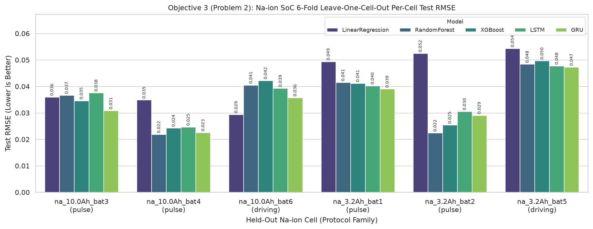
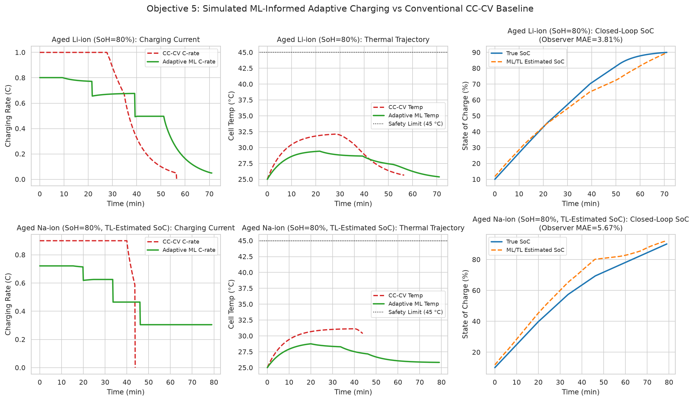

# UROP Cross-Chemistry BMS Framework — Experimental Report

**Project:** Machine Learning-Based State Estimation and Cross-Chemistry Transfer Learning for Battery Management Systems (Li-ion ↔ Na-ion)
**Pipeline Runtime:** `744.14 s` | **Data Mode:** `real_dataset`
**Real Laboratory Corpus:** `45/45` files present (`1357.11 MB`)

> **Data-Scope & Compatibility Note:** Exploratory SoH cross-chemistry mode: Na-ion SoH comprises 2 pooled Mendeley workbooks (na_nfm_25C at 25 °C and na_nfm_m15C at -15 °C) without cell IDs or cycle order. Sequence models (LSTM/GRU) are disabled for pooled SoH; tabular models only.

---

## 1. Columnar Out-of-Core Data Pipeline, Provenance & Quality Audit (Objectives 1 & 2)

All raw laboratory files are ingested into a local **Bronze → Silver → Gold Parquet** lakehouse using Polars and DuckDB out-of-core queries. See [`urop_core/DATA_NOTES.md`](../DATA_NOTES.md) for raw file inspections and provenance proof.

- **SoC Time-Series Sources (`ordered_per_cell`):**
  - **NASA Prognostics Li-ion (`5. Battery Data Set/`):** `33` ordered cells (`B0005`–`B0056`).
  - **Wang et al. (2025) Na-ion (`3.2Ah na-ion/` & `10Ah na-ion/`):** `6` ordered cells across 6 ambient temperatures (`0 °C` to `50 °C`): `bat1`/`bat2` (3.2 Ah pulse/stepped) and `bat5` (3.2 Ah driving cycles); `bat3`/`bat4` (10 Ah pulse/stepped) and `bat6` (10 Ah driving cycles).
- **SoH Degradation Sources:**
  - **NASA Li-ion (`ordered_per_cell`):** `33` independent cells with genuine sequential `cycle_number`. Used exclusively for within-chemistry Li-ion SoH training/validation/testing (tabular + LSTM/GRU).
  - **Mendeley `10.17632/4mztcdc4gt.1` (`pooled_unordered`):** 3 workbooks (`Dataset 1-1.xlsx` → `na_nfm_25C`, `Dataset 1-2.xlsx` → `na_nfm_m15C`, `Dataset 2.xlsx` → `li_ncm_25C`). Raw file diagnostics confirmed **no cell IDs**, **no cycle numbers**, strictly non-increasing capacity sorting in `Dataset 1-2` and `Dataset 2` (`0` upward steps), and **non-aligned Discharge vs Charge sheets** (`corr(diff(Q_max)) ≈ 0`). Each workbook is therefore loaded as **one Discharge-only unit** with `cycle_number = None` and `data_provenance = "pooled_unordered"`. Sequence models (LSTM/GRU) are strictly refused on pooled workbooks; `li_ncm_25C` is held out as an external pooled Li-ion test set and never mixed into NASA training.

### Lakehouse Quality Audit & Aggregation Summary
- **Time-Series Layer:** `49,938` Bronze rows → `49,745` Silver rows (`99.61%` retention; `90` bounds/null-filtered, `100` IsolationForest-filtered, `3` duplicates removed).
- **Cycle / Degradation Layer:** `8,500` Bronze records → `8,500` Silver records (`100.0%` retention; `0` removed).

| chemistry | data_provenance | n_units | n_records | min_soh | mean_soh | max_soh | avg_r_int_ohm | avg_temp_rise_c |
| --- | --- | --- | --- | --- | --- | --- | --- | --- |
| li_ion | ordered_per_cell | 33 | 2410 | 0.4926 | 0.8512 | 1.0482 | 0.1586 | 15.5900 |
| li_ion | pooled_unordered | 1 | 3351 | 0.7559 | 0.9184 | 1.0000 | 0.0357 | 2.8100 |
| na_ion | pooled_unordered | 2 | 2739 | 0.8553 | 0.9472 | 1.0000 | 0.0139 | 2.2600 |

### SoH Feature Scope & Cross-Dataset Mismatch Note
- **Partial-window discharge durations (`t_vnorm_upper_s`, `t_vnorm_mid_s`, `t_vnorm_lower_s`):** On Mendeley 1C constant-current discharge curves, time spent traversing fixed normalized voltage windows is proportional to incremental capacity $\Delta Q / I$ in those windows — an **indirect health indicator** (similar to ICA/DVA sub-window features), not a leakage-free independent proxy.
- **NASA vs Mendeley protocol mismatch:** NASA discharge cycles are measured at 2 A with varying cell cutoff voltages (2.0–2.7 V) and real temperature sensors, whereas Mendeley workbooks provide 1C fixed-window Discharge `Q(V)` curves without cell temperature telemetry. Cross-chemistry SoH transfer therefore combines both electrochemistry shift and test-protocol mismatch.

---

## 2. Unsupervised Data Mining & Domain-Shift Analysis (Objective 2)

- **Operating-Regime K-Means Clustering (4 regimes, physics-normalized SoC space):** Silhouette score = `0.3501`.
- **Domain Shift Reduction (NASA Li-ion vs Na-ion; SoH comparison is exploratory against pooled Mendeley NFM):**

| task | representation | mmd2 | mean_wasserstein_1 | mean_psi |
| --- | --- | --- | --- | --- |
| SoC | 1_raw_features | 0.1767 | 0.5656 | 2.0260 |
| SoC | 2_physics_normalized | 0.1132 | 0.4268 | 1.6545 |
| SoC | 3_physics_ocv_coral_aligned | 0.0852 | 0.3981 | 1.5183 |
| SoH | 1_raw_features | 0.8253 | 1.3414 | 7.5256 |
| SoH | 2_physics_normalized | 0.2319 | 0.7610 | 4.5789 |
| SoH | 3_physics_ocv_coral_aligned | 0.2540 | 0.5797 | 3.3489 |

---

## 3. Within-Chemistry Benchmarks & 6-Fold Na-ion SoC LOCO (Objective 3)

- **Li-ion SoC & SoH:** Cell-level train/val/test split over the `33` ordered NASA cells (no cell ever crosses train/val/test).
- **Na-ion SoC (`6-fold Leave-One-Cell-Out`):** Each of the `6` Wang et al. cells (all 6 temperatures kept together) is held out once as the test cell while training on 4 cells and validating on 1 cell. Sequence models (LSTM/GRU) use reduced epochs (`6` epochs per LOCO fold; `4` head + `5` full epochs in 6-fold LOCO Transfer Learning) for tractable CPU runtime across all 6 folds. Note protocol dependence: `bat1`/`bat2` (3.2 Ah) and `bat3`/`bat4` (10 Ah) share pulse/stepped profiles, whereas `bat5` and `bat6` carry driving-cycle profiles.
- **Na-ion SoH (`exploratory_lowo_temp_confounded`):** 2-fold Leave-One-Workbook-Out (`na_nfm_25C` at `25 °C` ↔ `na_nfm_m15C` at `-15 °C`), **tabular models only** (LSTM/GRU disabled on pooled unordered data). Temperature and workbook identity are confounded.

### 3.1 Summary Within-Chemistry Benchmarks

| task | chemistry | evaluation_mode | model | val_rmse | mae | rmse | rmse_std | r2 | r2_std | train_time_s |
| --- | --- | --- | --- | --- | --- | --- | --- | --- | --- | --- |
| SoC | li_ion | ordered_cell_split | LinearRegression | 0.1425 | 0.0715 | 0.1010 | nan | 0.8987 | nan | 0.0206 |
| SoC | li_ion | ordered_cell_split | RandomForest | 0.1099 | 0.0381 | 0.0693 | nan | 0.9523 | nan | 15.4101 |
| SoC | li_ion | ordered_cell_split | XGBoost | 0.1047 | 0.0433 | 0.0698 | nan | 0.9516 | nan | 0.5356 |
| SoC | li_ion | ordered_cell_split | LSTM | 0.0717 | 0.0427 | 0.0662 | nan | 0.9530 | nan | 19.1982 |
| SoC | li_ion | ordered_cell_split | GRU | 0.0711 | 0.0385 | 0.0633 | nan | 0.9570 | nan | 33.3289 |
| SoC | na_ion | leave_one_cell_out_6_folds | LinearRegression | 0.0419 | 0.0328 | 0.0427 | 0.0096 | 0.9707 | 0.0211 | 0.0186 |
| SoC | na_ion | leave_one_cell_out_6_folds | RandomForest | 0.0344 | 0.0252 | 0.0352 | 0.0099 | 0.9756 | 0.0211 | 13.0268 |
| SoC | na_ion | leave_one_cell_out_6_folds | XGBoost | 0.0360 | 0.0275 | 0.0362 | 0.0092 | 0.9743 | 0.0225 | 0.5366 |
| SoC | na_ion | leave_one_cell_out_6_folds | LSTM | 0.0332 | 0.0280 | 0.0367 | 0.0074 | 0.9754 | 0.0197 | 7.6806 |
| SoC | na_ion | leave_one_cell_out_6_folds | GRU | 0.0318 | 0.0262 | 0.0341 | 0.0079 | 0.9780 | 0.0190 | 12.4720 |
| SoH | li_ion | ordered_nasa_cell_split | LinearRegression | 0.1650 | 0.0419 | 0.0593 | nan | 0.6297 | nan | 0.0104 |
| SoH | li_ion | ordered_nasa_cell_split | RandomForest | 0.1002 | 0.0244 | 0.0343 | nan | 0.8762 | nan | 0.8238 |
| SoH | li_ion | ordered_nasa_cell_split | XGBoost | 0.1003 | 0.0273 | 0.0418 | nan | 0.8163 | nan | 0.1987 |
| SoH | li_ion | ordered_nasa_cell_split | LSTM | 0.0912 | 0.0490 | 0.0611 | nan | 0.5828 | nan | 1.4052 |
| SoH | li_ion | ordered_nasa_cell_split | GRU | 0.0867 | 0.0543 | 0.0679 | nan | 0.4835 | nan | 1.9968 |
| SoH | na_ion | exploratory_lowo_temp_confounded | LinearRegression | 0.0008 | 0.2595 | 0.2621 | 0.1725 | -96.4227 | 86.2595 | 0.0109 |
| SoH | na_ion | exploratory_lowo_temp_confounded | RandomForest | 0.0192 | 0.0240 | 0.0297 | 0.0136 | -0.0888 | 0.7290 | 0.7159 |
| SoH | na_ion | exploratory_lowo_temp_confounded | XGBoost | 0.0179 | 0.0281 | 0.0339 | 0.0152 | -0.4151 | 0.9307 | 0.1440 |

### 3.2 Na-ion SoC 6-Fold Leave-One-Cell-Out — Per-Cell Breakdown

| task | chemistry | test_cell | q_nom_ah | protocol_family | model | val_cell | val_rmse | mae | rmse | r2 | train_time_s | infer_time_ms |
| --- | --- | --- | --- | --- | --- | --- | --- | --- | --- | --- | --- | --- |
| SoC | na_ion | na_10.0Ah_bat3 | 10.0000 | pulse | LinearRegression | na_10.0Ah_bat4 | 0.0366 | 0.0259 | 0.0360 | 0.9872 | 0.0187 | 0.2410 |
| SoC | na_ion | na_10.0Ah_bat3 | 10.0000 | pulse | RandomForest | na_10.0Ah_bat4 | 0.0385 | 0.0245 | 0.0367 | 0.9867 | 12.9348 | 53.3170 |
| SoC | na_ion | na_10.0Ah_bat3 | 10.0000 | pulse | XGBoost | na_10.0Ah_bat4 | 0.0363 | 0.0254 | 0.0346 | 0.9881 | 0.5054 | 3.6510 |
| SoC | na_ion | na_10.0Ah_bat3 | 10.0000 | pulse | LSTM | na_10.0Ah_bat4 | 0.0383 | 0.0278 | 0.0375 | 0.9862 | 7.4033 | 61.5680 |
| SoC | na_ion | na_10.0Ah_bat3 | 10.0000 | pulse | GRU | na_10.0Ah_bat4 | 0.0309 | 0.0246 | 0.0308 | 0.9907 | 12.3023 | 58.2180 |
| SoC | na_ion | na_10.0Ah_bat4 | 10.0000 | pulse | LinearRegression | na_10.0Ah_bat6 | 0.0311 | 0.0257 | 0.0349 | 0.9879 | 0.0176 | 0.1890 |
| SoC | na_ion | na_10.0Ah_bat4 | 10.0000 | pulse | RandomForest | na_10.0Ah_bat6 | 0.0415 | 0.0129 | 0.0219 | 0.9953 | 13.0802 | 43.4330 |
| SoC | na_ion | na_10.0Ah_bat4 | 10.0000 | pulse | XGBoost | na_10.0Ah_bat6 | 0.0435 | 0.0167 | 0.0243 | 0.9942 | 0.5270 | 3.2790 |
| SoC | na_ion | na_10.0Ah_bat4 | 10.0000 | pulse | LSTM | na_10.0Ah_bat6 | 0.0345 | 0.0186 | 0.0246 | 0.9941 | 7.5056 | 38.8670 |
| SoC | na_ion | na_10.0Ah_bat4 | 10.0000 | pulse | GRU | na_10.0Ah_bat6 | 0.0326 | 0.0178 | 0.0225 | 0.9950 | 11.7185 | 51.5850 |
| SoC | na_ion | na_10.0Ah_bat6 | 10.0000 | driving | LinearRegression | na_3.2Ah_bat1 | 0.0464 | 0.0248 | 0.0294 | 0.9753 | 0.0176 | 0.2410 |
| SoC | na_ion | na_10.0Ah_bat6 | 10.0000 | driving | RandomForest | na_3.2Ah_bat1 | 0.0201 | 0.0351 | 0.0405 | 0.9530 | 12.6135 | 63.7670 |
| SoC | na_ion | na_10.0Ah_bat6 | 10.0000 | driving | XGBoost | na_3.2Ah_bat1 | 0.0236 | 0.0368 | 0.0422 | 0.9490 | 0.5334 | 5.4850 |
| SoC | na_ion | na_10.0Ah_bat6 | 10.0000 | driving | LSTM | na_3.2Ah_bat1 | 0.0286 | 0.0335 | 0.0393 | 0.9557 | 7.2202 | 57.7080 |
| SoC | na_ion | na_10.0Ah_bat6 | 10.0000 | driving | GRU | na_3.2Ah_bat1 | 0.0286 | 0.0296 | 0.0357 | 0.9633 | 12.7041 | 59.0710 |
| SoC | na_ion | na_3.2Ah_bat1 | 3.2000 | pulse | LinearRegression | na_3.2Ah_bat2 | 0.0503 | 0.0353 | 0.0493 | 0.9759 | 0.0195 | 0.2540 |
| SoC | na_ion | na_3.2Ah_bat1 | 3.2000 | pulse | RandomForest | na_3.2Ah_bat2 | 0.0431 | 0.0271 | 0.0415 | 0.9830 | 13.2646 | 64.6900 |
| SoC | na_ion | na_3.2Ah_bat1 | 3.2000 | pulse | XGBoost | na_3.2Ah_bat2 | 0.0434 | 0.0284 | 0.0412 | 0.9832 | 0.6752 | 5.4230 |
| SoC | na_ion | na_3.2Ah_bat1 | 3.2000 | pulse | LSTM | na_3.2Ah_bat2 | 0.0405 | 0.0289 | 0.0402 | 0.9841 | 8.4948 | 50.4100 |
| SoC | na_ion | na_3.2Ah_bat1 | 3.2000 | pulse | GRU | na_3.2Ah_bat2 | 0.0387 | 0.0285 | 0.0390 | 0.9850 | 13.0698 | 52.3910 |
| SoC | na_ion | na_3.2Ah_bat2 | 3.2000 | pulse | LinearRegression | na_3.2Ah_bat5 | 0.0604 | 0.0400 | 0.0524 | 0.9727 | 0.0194 | 0.2310 |
| SoC | na_ion | na_3.2Ah_bat2 | 3.2000 | pulse | RandomForest | na_3.2Ah_bat5 | 0.0504 | 0.0112 | 0.0224 | 0.9950 | 13.4389 | 63.7200 |
| SoC | na_ion | na_3.2Ah_bat2 | 3.2000 | pulse | XGBoost | na_3.2Ah_bat5 | 0.0530 | 0.0164 | 0.0254 | 0.9936 | 0.4753 | 5.2690 |
| SoC | na_ion | na_3.2Ah_bat2 | 3.2000 | pulse | LSTM | na_3.2Ah_bat5 | 0.0366 | 0.0203 | 0.0305 | 0.9908 | 7.3596 | 53.9570 |
| SoC | na_ion | na_3.2Ah_bat2 | 3.2000 | pulse | GRU | na_3.2Ah_bat5 | 0.0377 | 0.0201 | 0.0291 | 0.9917 | 12.9758 | 74.9460 |
| SoC | na_ion | na_3.2Ah_bat5 | 3.2000 | driving | LinearRegression | na_10.0Ah_bat3 | 0.0268 | 0.0451 | 0.0543 | 0.9253 | 0.0189 | 0.2180 |
| SoC | na_ion | na_3.2Ah_bat5 | 3.2000 | driving | RandomForest | na_10.0Ah_bat3 | 0.0130 | 0.0403 | 0.0484 | 0.9407 | 12.8286 | 63.8190 |
| SoC | na_ion | na_3.2Ah_bat5 | 3.2000 | driving | XGBoost | na_10.0Ah_bat3 | 0.0161 | 0.0412 | 0.0496 | 0.9375 | 0.5035 | 5.5180 |
| SoC | na_ion | na_3.2Ah_bat5 | 3.2000 | driving | LSTM | na_10.0Ah_bat3 | 0.0206 | 0.0392 | 0.0477 | 0.9414 | 8.0999 | 59.6670 |
| SoC | na_ion | na_3.2Ah_bat5 | 3.2000 | driving | GRU | na_10.0Ah_bat3 | 0.0224 | 0.0368 | 0.0473 | 0.9425 | 12.0613 | 70.2440 |

### 3.3 External Pooled Li-ion SoH Test Set (NASA-Trained Models → Mendeley NCM `li_ncm_25C`)

| task | train_source | external_test_unit | n_rows | model | mae | rmse | r2 |
| --- | --- | --- | --- | --- | --- | --- | --- |
| SoH | nasa_li_ion_33_ordered_cells | li_ncm_25C | 3351 | LinearRegression | 0.0818 | 0.0905 | -1.6718 |
| SoH | nasa_li_ion_33_ordered_cells | li_ncm_25C | 3351 | RandomForest | 0.1159 | 0.1304 | -4.5481 |
| SoH | nasa_li_ion_33_ordered_cells | li_ncm_25C | 3351 | XGBoost | 0.1056 | 0.1238 | -4.0026 |

### 3.4 Exploratory Na-ion SoH 2-Fold Leave-One-Workbook-Out (Temperature-Confounded, Tabular Only)

| task | chemistry | train_unit | test_unit | model | evaluation_mode | val_rmse | mae | rmse | r2 | train_time_s | infer_time_ms |
| --- | --- | --- | --- | --- | --- | --- | --- | --- | --- | --- | --- |
| SoH | na_ion | na_nfm_m15C | na_nfm_25C | LinearRegression | exploratory_lowo_temp_confounded | 0.0008 | 0.4334 | 0.4346 | -182.6822 | 0.0112 | 0.2090 |
| SoH | na_ion | na_nfm_m15C | na_nfm_25C | RandomForest | exploratory_lowo_temp_confounded | 0.0218 | 0.0347 | 0.0432 | -0.8178 | 0.6923 | 43.3880 |
| SoH | na_ion | na_nfm_m15C | na_nfm_25C | XGBoost | exploratory_lowo_temp_confounded | 0.0206 | 0.0408 | 0.0491 | -1.3458 | 0.1285 | 1.6810 |
| SoH | na_ion | na_nfm_25C | na_nfm_m15C | LinearRegression | exploratory_lowo_temp_confounded | 0.0006 | 0.0855 | 0.0896 | -10.1633 | 0.0107 | 0.1560 |
| SoH | na_ion | na_nfm_25C | na_nfm_m15C | RandomForest | exploratory_lowo_temp_confounded | 0.0166 | 0.0133 | 0.0161 | 0.6401 | 0.7395 | 34.1180 |
| SoH | na_ion | na_nfm_25C | na_nfm_m15C | XGBoost | exploratory_lowo_temp_confounded | 0.0152 | 0.0155 | 0.0187 | 0.5157 | 0.1595 | 1.7180 |

### 3.5 Repeated Cell-Level Split CV (Ordered Cells Only, Mean ± Std)

| task | setting | tier | model | n_splits | rmse_mean | rmse_std | r2_mean | r2_std |
| --- | --- | --- | --- | --- | --- | --- | --- | --- |
| SoC | li_ion_to_na_ion | 1_raw_zero_shot | RandomForest | 3 | 0.3710 | 0.0169 | -0.3676 | 0.1268 |
| SoC | li_ion_to_na_ion | 1_raw_zero_shot | XGBoost | 3 | 0.3612 | 0.0039 | -0.2941 | 0.0278 |
| SoC | li_ion_to_na_ion | 3_physics_ocv_coral_zero_shot | RandomForest | 3 | 0.2379 | 0.0291 | 0.4302 | 0.1392 |
| SoC | li_ion_to_na_ion | 3_physics_ocv_coral_zero_shot | XGBoost | 3 | 0.1934 | 0.0195 | 0.6252 | 0.0732 |
| SoC | na_ion_to_li_ion | 1_raw_zero_shot | RandomForest | 3 | 0.3275 | 0.0168 | -0.0826 | 0.0987 |
| SoC | na_ion_to_li_ion | 1_raw_zero_shot | XGBoost | 3 | 0.3311 | 0.0208 | -0.1074 | 0.1254 |
| SoC | na_ion_to_li_ion | 3_physics_ocv_coral_zero_shot | RandomForest | 3 | 0.2323 | 0.0281 | 0.4467 | 0.1446 |
| SoC | na_ion_to_li_ion | 3_physics_ocv_coral_zero_shot | XGBoost | 3 | 0.2336 | 0.0302 | 0.4393 | 0.1562 |
| SoC | within_li_ion | physics_normalized | LinearRegression | 3 | 0.1106 | 0.0105 | 0.8752 | 0.0259 |
| SoC | within_li_ion | physics_normalized | RandomForest | 3 | 0.0832 | 0.0124 | 0.9287 | 0.0216 |
| SoC | within_li_ion | physics_normalized | XGBoost | 3 | 0.0754 | 0.0057 | 0.9423 | 0.0090 |
| SoC | within_na_ion | physics_normalized | LinearRegression | 3 | 0.0439 | 0.0040 | 0.9807 | 0.0036 |
| SoC | within_na_ion | physics_normalized | RandomForest | 3 | 0.0275 | 0.0095 | 0.9916 | 0.0058 |
| SoC | within_na_ion | physics_normalized | XGBoost | 3 | 0.0302 | 0.0086 | 0.9902 | 0.0057 |
| SoH | within_li_ion | physics_normalized | LinearRegression | 3 | 0.0701 | 0.0080 | 0.5390 | 0.1058 |
| SoH | within_li_ion | physics_normalized | RandomForest | 3 | 0.0455 | 0.0111 | 0.8074 | 0.0666 |
| SoH | within_li_ion | physics_normalized | XGBoost | 3 | 0.0597 | 0.0167 | 0.6665 | 0.1410 |

---

## 4. Bidirectional Cross-Chemistry Zero-Shot Evaluation (Objective 4)

- **SoC `Li-ion → Na-ion`:** Evaluated jointly across **all `6` held-out Na-ion cells** as one target test set. Tier 3 unsupervised CORAL alignment uses unlabeled target input statistics (**transductive** alignment; zero target labels are used).
- **SoH `Li-ion ↔ Na-ion` (`exploratory_pooled`, tabular only):** Evaluated strictly with tabular models across ordered NASA Li-ion cells and the 2 pooled Mendeley NFM workbooks (sequence models omitted because pooled rows have no temporal order).

### 4.1 3-Tier Cross-Chemistry Ablation Table

| task | direction | evaluation_mode | tier | model | mae | rmse | r2 |
| --- | --- | --- | --- | --- | --- | --- | --- |
| SoC | li_ion_to_na_ion | all_6_na_cells_held_out_transductive_coral | 1_raw_zero_shot | LinearRegression | 0.2803 | 0.3480 | -0.3859 |
| SoC | li_ion_to_na_ion | all_6_na_cells_held_out_transductive_coral | 1_raw_zero_shot | RandomForest | 0.2957 | 0.3668 | -0.5402 |
| SoC | li_ion_to_na_ion | all_6_na_cells_held_out_transductive_coral | 1_raw_zero_shot | XGBoost | 0.3093 | 0.3765 | -0.6222 |
| SoC | li_ion_to_na_ion | all_6_na_cells_held_out_transductive_coral | 1_raw_zero_shot | LSTM | 0.3952 | 0.4533 | -1.3330 |
| SoC | li_ion_to_na_ion | all_6_na_cells_held_out_transductive_coral | 1_raw_zero_shot | GRU | 0.3786 | 0.4407 | -1.2051 |
| SoC | li_ion_to_na_ion | all_6_na_cells_held_out_transductive_coral | 2_physics_normalized_zero_shot | LinearRegression | 0.1820 | 0.2181 | 0.4556 |
| SoC | li_ion_to_na_ion | all_6_na_cells_held_out_transductive_coral | 2_physics_normalized_zero_shot | RandomForest | 0.1699 | 0.2392 | 0.3449 |
| SoC | li_ion_to_na_ion | all_6_na_cells_held_out_transductive_coral | 2_physics_normalized_zero_shot | XGBoost | 0.1497 | 0.2121 | 0.4849 |
| SoC | li_ion_to_na_ion | all_6_na_cells_held_out_transductive_coral | 2_physics_normalized_zero_shot | LSTM | 0.1817 | 0.2330 | 0.3837 |
| SoC | li_ion_to_na_ion | all_6_na_cells_held_out_transductive_coral | 2_physics_normalized_zero_shot | GRU | 0.1970 | 0.2472 | 0.3063 |
| SoC | li_ion_to_na_ion | all_6_na_cells_held_out_transductive_coral | 3_physics_ocv_coral_zero_shot | LinearRegression | 0.1216 | 0.1598 | 0.7079 |
| SoC | li_ion_to_na_ion | all_6_na_cells_held_out_transductive_coral | 3_physics_ocv_coral_zero_shot | RandomForest | 0.1421 | 0.1954 | 0.5628 |
| SoC | li_ion_to_na_ion | all_6_na_cells_held_out_transductive_coral | 3_physics_ocv_coral_zero_shot | XGBoost | 0.1129 | 0.1642 | 0.6913 |
| SoC | li_ion_to_na_ion | all_6_na_cells_held_out_transductive_coral | 3_physics_ocv_coral_zero_shot | LSTM | 0.1358 | 0.1782 | 0.6396 |
| SoC | li_ion_to_na_ion | all_6_na_cells_held_out_transductive_coral | 3_physics_ocv_coral_zero_shot | GRU | 0.1580 | 0.1988 | 0.5513 |
| SoC | na_ion_to_li_ion | held_out_li_test_cells | 1_raw_zero_shot | LinearRegression | 0.2632 | 0.3556 | -0.2552 |
| SoC | na_ion_to_li_ion | held_out_li_test_cells | 1_raw_zero_shot | RandomForest | 0.2438 | 0.3367 | -0.1255 |
| SoC | na_ion_to_li_ion | held_out_li_test_cells | 1_raw_zero_shot | XGBoost | 0.2528 | 0.3459 | -0.1879 |
| SoC | na_ion_to_li_ion | held_out_li_test_cells | 1_raw_zero_shot | LSTM | 0.2584 | 0.3395 | -0.2395 |
| SoC | na_ion_to_li_ion | held_out_li_test_cells | 1_raw_zero_shot | GRU | 0.2495 | 0.3263 | -0.1448 |
| SoC | na_ion_to_li_ion | held_out_li_test_cells | 2_physics_normalized_zero_shot | LinearRegression | 0.1635 | 0.2288 | 0.4805 |
| SoC | na_ion_to_li_ion | held_out_li_test_cells | 2_physics_normalized_zero_shot | RandomForest | 0.1592 | 0.2264 | 0.4914 |
| SoC | na_ion_to_li_ion | held_out_li_test_cells | 2_physics_normalized_zero_shot | XGBoost | 0.1617 | 0.2278 | 0.4850 |
| SoC | na_ion_to_li_ion | held_out_li_test_cells | 2_physics_normalized_zero_shot | LSTM | 0.1537 | 0.2022 | 0.5605 |
| SoC | na_ion_to_li_ion | held_out_li_test_cells | 2_physics_normalized_zero_shot | GRU | 0.1465 | 0.1984 | 0.5767 |
| SoC | na_ion_to_li_ion | held_out_li_test_cells | 3_physics_ocv_coral_zero_shot | LinearRegression | 0.1480 | 0.2080 | 0.5706 |
| SoC | na_ion_to_li_ion | held_out_li_test_cells | 3_physics_ocv_coral_zero_shot | RandomForest | 0.1454 | 0.2132 | 0.5490 |
| SoC | na_ion_to_li_ion | held_out_li_test_cells | 3_physics_ocv_coral_zero_shot | XGBoost | 0.1511 | 0.2158 | 0.5377 |
| SoC | na_ion_to_li_ion | held_out_li_test_cells | 3_physics_ocv_coral_zero_shot | LSTM | 0.1570 | 0.2056 | 0.5455 |
| SoC | na_ion_to_li_ion | held_out_li_test_cells | 3_physics_ocv_coral_zero_shot | GRU | 0.1527 | 0.2054 | 0.5465 |
| SoH | li_ion_to_na_ion | all_2_na_workbooks_held_out_exploratory | 1_raw_zero_shot | LinearRegression | 0.1139 | 0.1309 | -14.1630 |
| SoH | li_ion_to_na_ion | all_2_na_workbooks_held_out_exploratory | 1_raw_zero_shot | RandomForest | 0.2763 | 0.2787 | -67.7519 |
| SoH | li_ion_to_na_ion | all_2_na_workbooks_held_out_exploratory | 1_raw_zero_shot | XGBoost | 0.2258 | 0.2286 | -45.2767 |
| SoH | li_ion_to_na_ion | all_2_na_workbooks_held_out_exploratory | 2_physics_normalized_zero_shot | LinearRegression | 0.0759 | 0.0880 | -5.8476 |
| SoH | li_ion_to_na_ion | all_2_na_workbooks_held_out_exploratory | 2_physics_normalized_zero_shot | RandomForest | 0.0493 | 0.0706 | -3.4083 |
| SoH | li_ion_to_na_ion | all_2_na_workbooks_held_out_exploratory | 2_physics_normalized_zero_shot | XGBoost | 0.0546 | 0.0717 | -3.5581 |
| SoH | li_ion_to_na_ion | all_2_na_workbooks_held_out_exploratory | 3_physics_ocv_coral_zero_shot | LinearRegression | 0.0765 | 0.0889 | -5.9950 |
| SoH | li_ion_to_na_ion | all_2_na_workbooks_held_out_exploratory | 3_physics_ocv_coral_zero_shot | RandomForest | 0.0520 | 0.0726 | -3.6623 |
| SoH | li_ion_to_na_ion | all_2_na_workbooks_held_out_exploratory | 3_physics_ocv_coral_zero_shot | XGBoost | 0.0522 | 0.0691 | -3.2271 |
| SoH | na_ion_to_li_ion | held_out_li_test_cells | 1_raw_zero_shot | LinearRegression | 0.3204 | 0.3324 | -10.6218 |
| SoH | na_ion_to_li_ion | held_out_li_test_cells | 1_raw_zero_shot | RandomForest | 0.1023 | 0.1312 | -0.8111 |
| SoH | na_ion_to_li_ion | held_out_li_test_cells | 1_raw_zero_shot | XGBoost | 0.0907 | 0.1199 | -0.5128 |
| SoH | na_ion_to_li_ion | held_out_li_test_cells | 2_physics_normalized_zero_shot | LinearRegression | 0.1495 | 0.2050 | -3.4188 |
| SoH | na_ion_to_li_ion | held_out_li_test_cells | 2_physics_normalized_zero_shot | RandomForest | 0.0824 | 0.1070 | -0.2031 |
| SoH | na_ion_to_li_ion | held_out_li_test_cells | 2_physics_normalized_zero_shot | XGBoost | 0.0827 | 0.1063 | -0.1892 |
| SoH | na_ion_to_li_ion | held_out_li_test_cells | 3_physics_ocv_coral_zero_shot | LinearRegression | 0.1158 | 0.1600 | -1.6917 |
| SoH | na_ion_to_li_ion | held_out_li_test_cells | 3_physics_ocv_coral_zero_shot | RandomForest | 0.0820 | 0.1063 | -0.1893 |
| SoH | na_ion_to_li_ion | held_out_li_test_cells | 3_physics_ocv_coral_zero_shot | XGBoost | 0.0828 | 0.1061 | -0.1831 |

### 4.2 Per-Cell Breakdown: `Li-ion → Na-ion` SoC (XGBoost across all 6 held-out cells)

| task | direction | target_unit | alignment_scope | n_rows | raw_rmse | raw_r2 | phys_rmse | phys_r2 | aligned_rmse | aligned_r2 |
| --- | --- | --- | --- | --- | --- | --- | --- | --- | --- | --- |
| SoC | li_ion_to_na_ion | na_10.0Ah_bat3 | single_unit_transductive_coral | 3585 | 0.3412 | -0.1558 | 0.2045 | 0.5849 | 0.1633 | 0.7352 |
| SoC | li_ion_to_na_ion | na_10.0Ah_bat4 | single_unit_transductive_coral | 3584 | 0.3433 | -0.1696 | 0.2049 | 0.5835 | 0.1635 | 0.7349 |
| SoC | li_ion_to_na_ion | na_10.0Ah_bat6 | single_unit_transductive_coral | 3606 | 0.3425 | -2.3587 | 0.1727 | 0.1453 | 0.1544 | 0.3174 |
| SoC | li_ion_to_na_ion | na_3.2Ah_bat1 | single_unit_transductive_coral | 3573 | 0.3908 | -0.5127 | 0.2266 | 0.4914 | 0.1733 | 0.7024 |
| SoC | li_ion_to_na_ion | na_3.2Ah_bat2 | single_unit_transductive_coral | 3571 | 0.3917 | -0.5249 | 0.2245 | 0.4991 | 0.1704 | 0.7115 |
| SoC | li_ion_to_na_ion | na_3.2Ah_bat5 | single_unit_transductive_coral | 3606 | 0.4387 | -3.8794 | 0.2338 | -0.3856 | 0.1774 | 0.2025 |

### 4.3 Per-Workbook Breakdown: `Li-ion → Na-ion` SoH (Exploratory XGBoost across both NFM workbooks)

| task | direction | target_unit | alignment_scope | n_rows | raw_rmse | raw_r2 | phys_rmse | phys_r2 | aligned_rmse | aligned_r2 |
| --- | --- | --- | --- | --- | --- | --- | --- | --- | --- | --- |
| SoH | li_ion_to_na_ion | na_nfm_25C | single_unit_transductive_coral | 1528 | 0.2197 | -45.9378 | 0.0307 | 0.0842 | 0.0304 | 0.0987 |
| SoH | li_ion_to_na_ion | na_nfm_m15C | single_unit_transductive_coral | 1211 | 0.2394 | -78.6734 | 0.1023 | -13.5348 | 0.0980 | -12.3641 |

---

## 5. Few-Shot Cross-Chemistry Transfer Learning (`Li-ion → Na-ion`, Objective 4)

- **SoC Transfer Learning (`6-fold LOCO`):** For each held-out Na-ion test cell `c`, adaptation uses `5%, 10%, 25%, 50%` of the *other 5* Na-ion cells (strictly asserting `c` never enters adaptation or empirical OCV estimation), averaged across all 6 folds.
- **SoH Transfer Learning (`exploratory_cross_workbook_temp_confounded`, tabular only):** Adaptation samples `5%, 10%, 25%, 50%` strictly from Workbook A (`25 °C` or `-15 °C`) and evaluates on 100% of Workbook B (opposite temperature), averaged across both directions. No intra-workbook random splits and no sequence models are used.

| task | direction | evaluation_mode | target_fraction | n_folds | n_target_samples | method | rmse | rmse_std | r2 | adapt_time_s |
| --- | --- | --- | --- | --- | --- | --- | --- | --- | --- | --- |
| SoC | li_ion_to_na_ion | loco_6_folds | 0.0000 | 6 | 0 | ZeroShot_Aligned_GRU | 0.2043 | 0.0260 | 0.2913 | 0.0000 |
| SoC | li_ion_to_na_ion | loco_6_folds | 0.0000 | 6 | 0 | ZeroShot_Aligned_XGBoost | 0.1695 | 0.0153 | 0.5718 | 0.0000 |
| SoC | li_ion_to_na_ion | loco_6_folds | 0.0500 | 6 | 897 | TL_Residual_XGBoost | 0.0526 | 0.0051 | 0.9529 | 0.0469 |
| SoC | li_ion_to_na_ion | loco_6_folds | 0.0500 | 6 | 880 | TL_TwoPhase_GRU | 0.0454 | 0.0070 | 0.9625 | 1.3343 |
| SoC | li_ion_to_na_ion | loco_6_folds | 0.0500 | 6 | 897 | TL_WarmStart_XGBoost | 0.0776 | 0.0047 | 0.9032 | 0.0355 |
| SoC | li_ion_to_na_ion | loco_6_folds | 0.0500 | 6 | 880 | TargetOnly_GRU | 0.0716 | 0.0297 | 0.9012 | 0.8427 |
| SoC | li_ion_to_na_ion | loco_6_folds | 0.0500 | 6 | 897 | TargetOnly_XGBoost | 0.0376 | 0.0083 | 0.9730 | 0.0634 |
| SoC | li_ion_to_na_ion | loco_6_folds | 0.1000 | 6 | 1794 | TL_Residual_XGBoost | 0.0515 | 0.0064 | 0.9537 | 0.0529 |
| SoC | li_ion_to_na_ion | loco_6_folds | 0.1000 | 6 | 1761 | TL_TwoPhase_GRU | 0.0421 | 0.0073 | 0.9664 | 2.5303 |
| SoC | li_ion_to_na_ion | loco_6_folds | 0.1000 | 6 | 1794 | TL_WarmStart_XGBoost | 0.0776 | 0.0065 | 0.9018 | 0.0395 |
| SoC | li_ion_to_na_ion | loco_6_folds | 0.1000 | 6 | 1761 | TargetOnly_GRU | 0.0588 | 0.0107 | 0.9414 | 1.0979 |
| SoC | li_ion_to_na_ion | loco_6_folds | 0.1000 | 6 | 1794 | TargetOnly_XGBoost | 0.0371 | 0.0093 | 0.9727 | 0.0651 |
| SoC | li_ion_to_na_ion | loco_6_folds | 0.2500 | 6 | 4484 | TL_Residual_XGBoost | 0.0489 | 0.0061 | 0.9583 | 0.1595 |
| SoC | li_ion_to_na_ion | loco_6_folds | 0.2500 | 6 | 4402 | TL_TwoPhase_GRU | 0.0365 | 0.0092 | 0.9730 | 6.0848 |
| SoC | li_ion_to_na_ion | loco_6_folds | 0.2500 | 6 | 4484 | TL_WarmStart_XGBoost | 0.0758 | 0.0053 | 0.9073 | 0.0483 |
| SoC | li_ion_to_na_ion | loco_6_folds | 0.2500 | 6 | 4402 | TargetOnly_GRU | 0.0539 | 0.0209 | 0.9505 | 2.3306 |
| SoC | li_ion_to_na_ion | loco_6_folds | 0.2500 | 6 | 4484 | TargetOnly_XGBoost | 0.0353 | 0.0100 | 0.9738 | 0.1727 |
| SoC | li_ion_to_na_ion | loco_6_folds | 0.5000 | 6 | 8969 | TL_Residual_XGBoost | 0.0482 | 0.0070 | 0.9585 | 0.1788 |
| SoC | li_ion_to_na_ion | loco_6_folds | 0.5000 | 6 | 8804 | TL_TwoPhase_GRU | 0.0348 | 0.0071 | 0.9768 | 12.0832 |
| SoC | li_ion_to_na_ion | loco_6_folds | 0.5000 | 6 | 8969 | TL_WarmStart_XGBoost | 0.0758 | 0.0062 | 0.9061 | 0.0636 |
| SoC | li_ion_to_na_ion | loco_6_folds | 0.5000 | 6 | 8804 | TargetOnly_GRU | 0.0398 | 0.0085 | 0.9693 | 4.5011 |
| SoC | li_ion_to_na_ion | loco_6_folds | 0.5000 | 6 | 8969 | TargetOnly_XGBoost | 0.0350 | 0.0103 | 0.9740 | 0.1864 |
| SoH | li_ion_to_na_ion | exploratory_cross_workbook_temp_confounded | 0.0000 | 2 | 0 | ZeroShot_Aligned_XGBoost | 0.0649 | 0.0312 | -5.9752 | 0.0000 |
| SoH | li_ion_to_na_ion | exploratory_cross_workbook_temp_confounded | 0.0500 | 2 | 68 | TL_Residual_XGBoost | 0.1028 | 0.0081 | -11.9038 | 0.0266 |
| SoH | li_ion_to_na_ion | exploratory_cross_workbook_temp_confounded | 0.0500 | 2 | 68 | TL_WarmStart_XGBoost | 0.0897 | 0.0001 | -8.5029 | 0.0294 |
| SoH | li_ion_to_na_ion | exploratory_cross_workbook_temp_confounded | 0.0500 | 2 | 68 | TargetOnly_XGBoost | 0.0409 | 0.0143 | -0.9684 | 0.0302 |
| SoH | li_ion_to_na_ion | exploratory_cross_workbook_temp_confounded | 0.1000 | 2 | 137 | TL_Residual_XGBoost | 0.1010 | 0.0203 | -12.3875 | 0.0319 |
| SoH | li_ion_to_na_ion | exploratory_cross_workbook_temp_confounded | 0.1000 | 2 | 137 | TL_WarmStart_XGBoost | 0.0878 | 0.0247 | -9.7257 | 0.0335 |
| SoH | li_ion_to_na_ion | exploratory_cross_workbook_temp_confounded | 0.1000 | 2 | 137 | TargetOnly_XGBoost | 0.0367 | 0.0152 | -0.6338 | 0.0365 |
| SoH | li_ion_to_na_ion | exploratory_cross_workbook_temp_confounded | 0.2500 | 2 | 342 | TL_Residual_XGBoost | 0.0953 | 0.0236 | -11.3388 | 0.0393 |
| SoH | li_ion_to_na_ion | exploratory_cross_workbook_temp_confounded | 0.2500 | 2 | 342 | TL_WarmStart_XGBoost | 0.0940 | 0.0218 | -10.8432 | 0.0369 |
| SoH | li_ion_to_na_ion | exploratory_cross_workbook_temp_confounded | 0.2500 | 2 | 342 | TargetOnly_XGBoost | 0.0377 | 0.0167 | -0.7483 | 0.0468 |
| SoH | li_ion_to_na_ion | exploratory_cross_workbook_temp_confounded | 0.5000 | 2 | 685 | TL_Residual_XGBoost | 0.0808 | 0.0270 | -8.4790 | 0.0411 |
| SoH | li_ion_to_na_ion | exploratory_cross_workbook_temp_confounded | 0.5000 | 2 | 685 | TL_WarmStart_XGBoost | 0.0879 | 0.0194 | -9.2777 | 0.0398 |
| SoH | li_ion_to_na_ion | exploratory_cross_workbook_temp_confounded | 0.5000 | 2 | 685 | TargetOnly_XGBoost | 0.0345 | 0.0149 | -0.4520 | 0.0519 |

---

## 6. Adaptive Charging Simulation Study vs CC-CV Baseline (Proposal §5.7, Objective 5)

> **Simulation Study Note (Proposal §5.7):** These results come from a closed-loop **simulation study** on an independent 2-RC electro-thermal plant with deliberate controller-plant mismatch (+12% resistance offset, unmodeled slow diffusion RC polarization, charging hysteresis, and 0.5% current bias) using empirical training-cell OCV curves. They are **not** physical hardware bench measurements. The closed-loop `soc_observer_mae` is reported beside every metric so observer error is transparent.

| chemistry | scenario | strategy | charge_time_min | peak_temp_c | peak_temp_rise_c | energy_efficiency_pct | estimated_degradation_pct | soc_observer_mae | safety_limits_respected |
| --- | --- | --- | --- | --- | --- | --- | --- | --- | --- |
| li_ion | li_ion_soh98 | CC-CV | 61.1700 | 30.6100 | 5.6100 | 92.5500 | 0.0185 | 0.0168 | True |
| li_ion | li_ion_soh98 | Adaptive_ML | 71.1700 | 29.7100 | 4.7100 | 93.4400 | 0.0157 | 0.0318 | True |
| li_ion | li_ion_soh80 | CC-CV | 56.5000 | 32.1200 | 7.1200 | 90.9300 | 0.0238 | 0.0177 | True |
| li_ion | li_ion_soh80 | Adaptive_ML | 71.0000 | 29.4300 | 4.4300 | 92.7300 | 0.0178 | 0.0381 | True |
| na_ion | na_ion_soh98 | CC-CV | 52.8300 | 29.7500 | 4.7500 | 92.1500 | 0.0221 | 0.0689 | True |
| na_ion | na_ion_soh98 | Adaptive_ML | 80.1700 | 29.0300 | 4.0300 | 93.7400 | 0.0168 | 0.0599 | True |
| na_ion | na_ion_soh80 | CC-CV | 43.8300 | 31.1300 | 6.1300 | 90.2700 | 0.0292 | 0.0502 | True |
| na_ion | na_ion_soh80 | Adaptive_ML | 79.0000 | 28.7600 | 3.7600 | 93.1400 | 0.0189 | 0.0567 | True |

---

## 7. Limitations

1. **Mendeley SoH Workbooks Lack Cell Identities and Cycle Order (`pooled_unordered`):** Raw file inspection proved `Dataset 1-1.xlsx`, `Dataset 1-2.xlsx`, and `Dataset 2.xlsx` contain no cell IDs or cycle numbers, have non-aligned Discharge/Charge sheets, and are sorted by capacity in `Dataset 1-2` and `Dataset 2`. Consequently, Na-ion SoH has only **2 independent workbook units** (`25 °C` vs `-15 °C`, confounded with temperature), preventing cell-level CV, sequence modeling (LSTM/GRU), or cycle-rate fade claims. All Na-ion SoH and cross-chemistry SoH results must be interpreted as **exploratory**.
2. **NASA vs Mendeley SoH Feature & Protocol Mismatch:** NASA discharge cycles use 2 A constant current across varying cell cutoff voltages with real cell temperature sensors, whereas Mendeley workbooks provide 1C fixed-window discharge `Q(V)` curves without temperature telemetry. Partial-window 1C durations act as indirect capacity-correlated health indicators rather than protocol-invariant physical constants.
3. **Small Na-ion SoC Cell Count (`N = 6`) & Protocol Coupling:** Although 6-fold Leave-One-Cell-Out eliminates the variance of a single 2-cell split, 6 cells remain a small sample where `bat1`/`bat2` (3.2 Ah) and `bat3`/`bat4` (10 Ah) share stepped-pulse protocols while `bat5`/`bat6` cover driving cycles; generalization to unseen Na-ion form factors or cathode chemistries (beyond Wang et al.) is not established here.
4. **Transductive Nature of Unsupervised CORAL Alignment:** In Tier 3 zero-shot `Li-ion → Na-ion` evaluation over all 6 held-out Na-ion cells, unsupervised CORAL computes covariance alignment using unlabeled target-domain inputs. While zero target labels are used, online single-cell deployment before observing a full target voltage/current distribution would require streaming or batch warmup.
5. **Simulation-Only Adaptive Charging (Proposal §5.7):** Objective 5 evaluates ML/TL-informed charging inside an electro-thermal 2-RC simulation plant rather than on physical cycler hardware; thermal reductions, degradation index improvements, and zero safety-limit violations are conditional on the 2-RC plant model and must be interpreted alongside each scenario's closed-loop `soc_observer_mae`.
