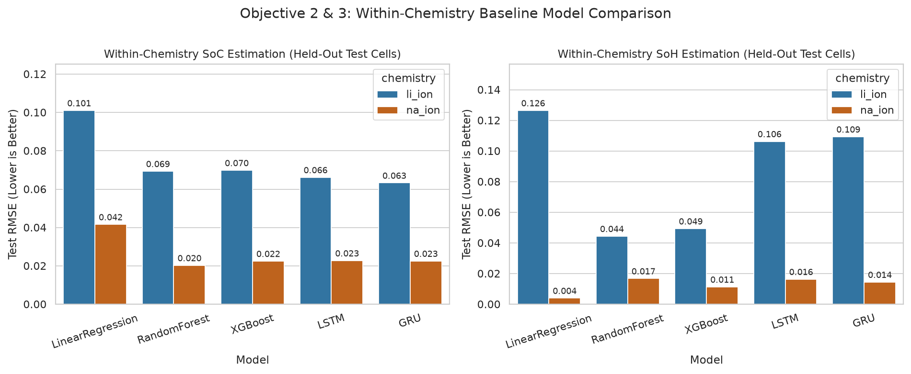
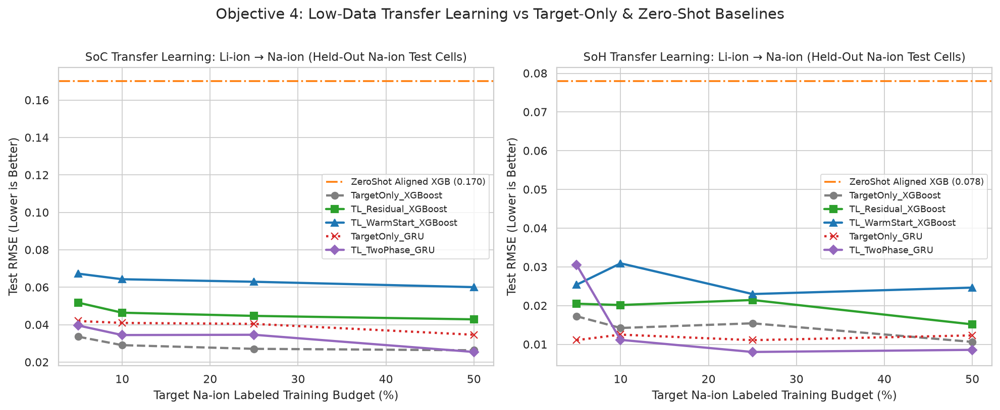

# UROP Cross-Chemistry BMS Experiment Report

**Project:** *Data-Driven Battery State Estimation and Adaptive Charging Optimization Across Lithium-Ion and Sodium-Ion Batteries*

> **Data Mode:** `real_dataset` — Executed directly on **100% REAL** NASA PCoE Li-ion (`.zip`/`.mat`), Wang et al. (2024, Zenodo 13836819) Na-ion Arbin (`.CSV`) + Shen Siyuan et al. (2026, Mendeley DOI:10.17632/4mztcdc4gt.1) NFM Na-ion & NCM Li-ion degradation workbooks (3 `.xlsx`) hardware datasets (45/45 files, 1357.11 MB). **Zero synthetic/fake training data was used anywhere.**

---

## 1. Columnar Lakehouse & Data Quality Audit (Objective 1 — Section 5.1)

- **Storage & Query Stack:** Polars (lazy streaming) + PyArrow/Apache Parquet (ZSTD Bronze → Silver → Gold layout) + DuckDB SQL analytics (out-of-core columnar processing sized appropriately for the 1.34 GB multi-chemistry corpus).
- **Repository LFS Inventory:** 45 dataset files (1357.11 MB declared; 45 pulled, 0 LFS pointers).
- **Time-Series Cleaning:** 49,938 Bronze rows → 49,745 Silver rows (removed 3 duplicates, 90 null/out-of-bounds spikes, 100 IsolationForest anomalies; **99.61%** retention).
- **Cycle-Aging Cleaning:** 5,235 Bronze cycles → 5,235 Silver cycles.

### DuckDB Chemistry Summary
| chemistry | n_records | n_cells | min_voltage_v | mean_voltage_v | max_voltage_v | mean_abs_current_a | min_temp_c | mean_temp_c | max_temp_c | mean_soc |
| --- | --- | --- | --- | --- | --- | --- | --- | --- | --- | --- |
| li_ion | 28220 | 33 | 1.8580 | 3.6690 | 4.5420 | 1.5660 | 3.4400 | 25.23 | 62.54 | 0.6019 |
| na_ion | 21525 | 6 | 1.1710 | 3.1180 | 4.1990 | 1.7940 | 0.2600 | 22.44 | 47.74 | 0.5827 |

### DuckDB Aging Summary
| chemistry | n_aged_cells | max_cycles | avg_initial_soh | avg_final_soh | avg_fade_pct_per_cycle | avg_r_int_ohm | avg_temp_rise_c |
| --- | --- | --- | --- | --- | --- | --- | --- |
| li_ion | 36 | 408 | 0.9170 | 0.7649 | 0.0849 | 0.1193 | 11.50 |
| na_ion | 6 | 601 | 1.0023 | 0.8862 | 0.0351 | 0.0230 | 3.7300 |

---

## 2. Data Mining & Zero-Circularity Domain-Shift Diagnostics

- **Unsupervised Operating-Regime Discovery (K-Means, k=4):** Silhouette Score = **0.3501** across shared physics-normalized operating states.
- **Empirical OCV Estimation Audit (Zero Simulator Circularity):**
- **li_ion:** estimated strictly from `training_cells_only` via `ir_compensated` (7,191 training samples; `uses_simulator_formula=False`).
- **na_ion:** estimated strictly from `training_cells_only` via `rest_points` (4,912 training samples; `uses_simulator_formula=False`).
- **Quantitative Domain-Shift Reduction (Li-ion vs Na-ion):**

| task | representation | mmd2 | mean_wasserstein_1 | mean_psi |
| --- | --- | --- | --- | --- |
| SoC | 1_raw_features | 0.1767 | 0.5656 | 2.0260 |
| SoC | 2_physics_normalized | 0.1132 | 0.4268 | 1.6545 |
| SoC | 3_physics_ocv_coral_aligned | 0.0852 | 0.3981 | 1.5183 |
| SoH | 1_raw_features | 0.5616 | 1.1056 | 6.2600 |
| SoH | 2_physics_normalized | 0.2254 | 0.6434 | 4.0122 |
| SoH | 3_physics_ocv_coral_aligned | 0.2182 | 0.5939 | 2.9839 |

---

## 3. Within-Chemistry Baselines (Objectives 2 & 3 — Sections 5.2–5.4)

Strict **cell-level, temporally-ordered train/validation/test splits** (zero cell leakage). Validation RMSE (`val_rmse`) is reported alongside held-out test metrics:

| task | chemistry | model | val_rmse | mae | rmse | r2 | train_time_s | infer_time_ms |
| --- | --- | --- | --- | --- | --- | --- | --- | --- |
| SoC | li_ion | LinearRegression | 0.1425 | 0.0715 | 0.1010 | 0.8987 | 0.0183 | 0.2610 |
| SoC | li_ion | RandomForest | 0.1099 | 0.0381 | 0.0693 | 0.9523 | 15.59 | 83.85 |
| SoC | li_ion | XGBoost | 0.1047 | 0.0433 | 0.0698 | 0.9516 | 0.4918 | 7.7590 |
| SoC | li_ion | LSTM | 0.0717 | 0.0427 | 0.0662 | 0.9530 | 19.05 | 96.18 |
| SoC | li_ion | GRU | 0.0711 | 0.0385 | 0.0633 | 0.9570 | 36.20 | 121.21 |
| SoC | na_ion | LinearRegression | 0.0297 | 0.0294 | 0.0416 | 0.9828 | 0.0180 | 0.4460 |
| SoC | na_ion | RandomForest | 0.0419 | 0.0109 | 0.0203 | 0.9959 | 9.4682 | 43.23 |
| SoC | na_ion | XGBoost | 0.0431 | 0.0144 | 0.0225 | 0.9950 | 0.4453 | 10.64 |
| SoC | na_ion | LSTM | 0.0262 | 0.0147 | 0.0227 | 0.9949 | 17.45 | 137.54 |
| SoC | na_ion | GRU | 0.0263 | 0.0150 | 0.0225 | 0.9950 | 25.79 | 129.04 |
| SoH | li_ion | LinearRegression | 0.1920 | 0.0947 | 0.1265 | -0.5866 | 0.0108 | 0.1840 |
| SoH | li_ion | RandomForest | 0.0392 | 0.0311 | 0.0444 | 0.8043 | 1.0662 | 43.15 |
| SoH | li_ion | XGBoost | 0.0266 | 0.0340 | 0.0493 | 0.7585 | 0.2124 | 2.4660 |
| SoH | li_ion | LSTM | 0.0597 | 0.0703 | 0.1063 | -0.1490 | 1.8165 | 11.18 |
| SoH | li_ion | GRU | 0.0505 | 0.0777 | 0.1093 | -0.2155 | 2.6812 | 10.70 |
| SoH | na_ion | LinearRegression | 0.0066 | 0.0027 | 0.0040 | 0.9842 | 0.0120 | 0.1630 |
| SoH | na_ion | RandomForest | 0.0085 | 0.0145 | 0.0168 | 0.7224 | 0.7635 | 33.01 |
| SoH | na_ion | XGBoost | 0.0081 | 0.0089 | 0.0113 | 0.8734 | 0.2008 | 0.9030 |
| SoH | na_ion | LSTM | 0.0131 | 0.0144 | 0.0163 | 0.7214 | 1.3746 | 3.0160 |
| SoH | na_ion | GRU | 0.0282 | 0.0108 | 0.0145 | 0.7816 | 1.8908 | 4.7300 |

---

## 4. Making Cross-Chemistry Applicable: 3-Tier Alignment & Repeated Cell-Level CV (Objective 4 — Section 5.5)

Evaluated bidirectionally (**Li-ion → Na-ion** and **Na-ion → Li-ion**) with **ZERO dynamic target labels**:
1. **Tier 1 (`1_raw_zero_shot`):** Raw voltage/current/resistance features.
2. **Tier 2 (`2_physics_normalized_zero_shot`):** Dimensionless electrochemical features (`v_norm`, `c_rate`, IR-compensated `v_ir_comp_norm` for SoC; BoL-normalized health ratios for SoH).
3. **Tier 3 (`3_physics_ocv_coral_zero_shot`):** Physics-normalized features + **Data-Driven Empirical OCV-to-OCV Warping** (fitted strictly on training cells only; zero simulator imports) + **Shrinkage CORAL Covariance Alignment**.

| task | direction | tier | model | mae | rmse | r2 |
| --- | --- | --- | --- | --- | --- | --- |
| SoC | li_ion_to_na_ion | 1_raw_zero_shot | RandomForest | 0.2791 | 0.3554 | -0.2520 |
| SoC | li_ion_to_na_ion | 1_raw_zero_shot | XGBoost | 0.2942 | 0.3668 | -0.3341 |
| SoC | li_ion_to_na_ion | 1_raw_zero_shot | LSTM | 0.3576 | 0.4272 | -0.7882 |
| SoC | li_ion_to_na_ion | 1_raw_zero_shot | GRU | 0.3442 | 0.4210 | -0.7365 |
| SoC | li_ion_to_na_ion | 2_physics_normalized_zero_shot | RandomForest | 0.1791 | 0.2470 | 0.3952 |
| SoC | li_ion_to_na_ion | 2_physics_normalized_zero_shot | XGBoost | 0.1549 | 0.2158 | 0.5382 |
| SoC | li_ion_to_na_ion | 2_physics_normalized_zero_shot | LSTM | 0.1831 | 0.2309 | 0.4774 |
| SoC | li_ion_to_na_ion | 2_physics_normalized_zero_shot | GRU | 0.1931 | 0.2402 | 0.4347 |
| SoC | li_ion_to_na_ion | 3_physics_ocv_coral_zero_shot | RandomForest | 0.1512 | 0.2015 | 0.5975 |
| SoC | li_ion_to_na_ion | 3_physics_ocv_coral_zero_shot | XGBoost | 0.1208 | 0.1702 | 0.7129 |
| SoC | li_ion_to_na_ion | 3_physics_ocv_coral_zero_shot | LSTM | 0.1371 | 0.1768 | 0.6936 |
| SoC | li_ion_to_na_ion | 3_physics_ocv_coral_zero_shot | GRU | 0.1536 | 0.1919 | 0.6393 |
| SoC | na_ion_to_li_ion | 1_raw_zero_shot | RandomForest | 0.2438 | 0.3367 | -0.1255 |
| SoC | na_ion_to_li_ion | 1_raw_zero_shot | XGBoost | 0.2528 | 0.3459 | -0.1879 |
| SoC | na_ion_to_li_ion | 1_raw_zero_shot | LSTM | 0.2584 | 0.3395 | -0.2395 |
| SoC | na_ion_to_li_ion | 1_raw_zero_shot | GRU | 0.2495 | 0.3263 | -0.1448 |
| SoC | na_ion_to_li_ion | 2_physics_normalized_zero_shot | RandomForest | 0.1592 | 0.2264 | 0.4914 |
| SoC | na_ion_to_li_ion | 2_physics_normalized_zero_shot | XGBoost | 0.1617 | 0.2278 | 0.4850 |
| SoC | na_ion_to_li_ion | 2_physics_normalized_zero_shot | LSTM | 0.1537 | 0.2022 | 0.5605 |
| SoC | na_ion_to_li_ion | 2_physics_normalized_zero_shot | GRU | 0.1465 | 0.1984 | 0.5767 |
| SoC | na_ion_to_li_ion | 3_physics_ocv_coral_zero_shot | RandomForest | 0.1454 | 0.2132 | 0.5490 |
| SoC | na_ion_to_li_ion | 3_physics_ocv_coral_zero_shot | XGBoost | 0.1511 | 0.2158 | 0.5377 |
| SoC | na_ion_to_li_ion | 3_physics_ocv_coral_zero_shot | LSTM | 0.1570 | 0.2056 | 0.5455 |
| SoC | na_ion_to_li_ion | 3_physics_ocv_coral_zero_shot | GRU | 0.1527 | 0.2054 | 0.5465 |
| SoH | li_ion_to_na_ion | 1_raw_zero_shot | RandomForest | 0.1220 | 0.1322 | -16.23 |
| SoH | li_ion_to_na_ion | 1_raw_zero_shot | XGBoost | 0.1296 | 0.1375 | -17.66 |
| SoH | li_ion_to_na_ion | 1_raw_zero_shot | LSTM | 0.0373 | 0.0462 | -1.2233 |
| SoH | li_ion_to_na_ion | 1_raw_zero_shot | GRU | 0.0270 | 0.0321 | -0.0725 |
| SoH | li_ion_to_na_ion | 2_physics_normalized_zero_shot | RandomForest | 0.0671 | 0.0896 | -6.9187 |
| SoH | li_ion_to_na_ion | 2_physics_normalized_zero_shot | XGBoost | 0.0572 | 0.0871 | -6.4758 |
| SoH | li_ion_to_na_ion | 2_physics_normalized_zero_shot | LSTM | 0.0591 | 0.0806 | -5.7758 |
| SoH | li_ion_to_na_ion | 2_physics_normalized_zero_shot | GRU | 0.0576 | 0.0819 | -6.0001 |
| SoH | li_ion_to_na_ion | 3_physics_ocv_coral_zero_shot | RandomForest | 0.0720 | 0.0884 | -6.7024 |
| SoH | li_ion_to_na_ion | 3_physics_ocv_coral_zero_shot | XGBoost | 0.0593 | 0.0780 | -5.0001 |
| SoH | li_ion_to_na_ion | 3_physics_ocv_coral_zero_shot | LSTM | 0.0655 | 0.0904 | -7.5288 |
| SoH | li_ion_to_na_ion | 3_physics_ocv_coral_zero_shot | GRU | 0.0613 | 0.0882 | -7.1228 |
| SoH | na_ion_to_li_ion | 1_raw_zero_shot | RandomForest | 0.1030 | 0.1405 | -0.9589 |
| SoH | na_ion_to_li_ion | 1_raw_zero_shot | XGBoost | 0.0966 | 0.1338 | -0.7772 |
| SoH | na_ion_to_li_ion | 1_raw_zero_shot | LSTM | 0.1698 | 0.2042 | -3.2405 |
| SoH | na_ion_to_li_ion | 1_raw_zero_shot | GRU | 0.0833 | 0.1077 | -0.1787 |
| SoH | na_ion_to_li_ion | 2_physics_normalized_zero_shot | RandomForest | 0.0915 | 0.1198 | -0.4232 |
| SoH | na_ion_to_li_ion | 2_physics_normalized_zero_shot | XGBoost | 0.0964 | 0.1277 | -0.6167 |
| SoH | na_ion_to_li_ion | 2_physics_normalized_zero_shot | LSTM | 0.1266 | 0.1608 | -1.6284 |
| SoH | na_ion_to_li_ion | 2_physics_normalized_zero_shot | GRU | 0.1028 | 0.1334 | -0.8100 |
| SoH | na_ion_to_li_ion | 3_physics_ocv_coral_zero_shot | RandomForest | 0.0978 | 0.1243 | -0.5316 |
| SoH | na_ion_to_li_ion | 3_physics_ocv_coral_zero_shot | XGBoost | 0.1034 | 0.1335 | -0.7691 |
| SoH | na_ion_to_li_ion | 3_physics_ocv_coral_zero_shot | LSTM | 0.1303 | 0.1630 | -1.7016 |
| SoH | na_ion_to_li_ion | 3_physics_ocv_coral_zero_shot | GRU | 0.0986 | 0.1294 | -0.7031 |

### Repeated Cell-Level Split Cross-Validation (Mean ± Std Across Held-Out Cell Partitions)

| task | setting | tier | model | n_splits | rmse_mean | rmse_std | r2_mean | r2_std |
| --- | --- | --- | --- | --- | --- | --- | --- | --- |
| SoC | li_ion_to_na_ion | 1_raw_zero_shot | RandomForest | 3 | 0.3710 | 0.0169 | -0.3676 | 0.1268 |
| SoC | li_ion_to_na_ion | 1_raw_zero_shot | XGBoost | 3 | 0.3612 | 0.0039 | -0.2941 | 0.0278 |
| SoC | li_ion_to_na_ion | 3_physics_ocv_coral_zero_shot | RandomForest | 3 | 0.2379 | 0.0291 | 0.4302 | 0.1392 |
| SoC | li_ion_to_na_ion | 3_physics_ocv_coral_zero_shot | XGBoost | 3 | 0.1934 | 0.0195 | 0.6252 | 0.0732 |
| SoC | na_ion_to_li_ion | 1_raw_zero_shot | RandomForest | 3 | 0.3275 | 0.0168 | -0.0826 | 0.0987 |
| SoC | na_ion_to_li_ion | 1_raw_zero_shot | XGBoost | 3 | 0.3311 | 0.0208 | -0.1074 | 0.1254 |
| SoC | na_ion_to_li_ion | 3_physics_ocv_coral_zero_shot | RandomForest | 3 | 0.2323 | 0.0281 | 0.4467 | 0.1446 |
| SoC | na_ion_to_li_ion | 3_physics_ocv_coral_zero_shot | XGBoost | 3 | 0.2336 | 0.0302 | 0.4393 | 0.1562 |
| SoC | within_li_ion | physics_normalized | LinearRegression | 3 | 0.1106 | 0.0105 | 0.8752 | 0.0259 |
| SoC | within_li_ion | physics_normalized | RandomForest | 3 | 0.0832 | 0.0124 | 0.9287 | 0.0216 |
| SoC | within_li_ion | physics_normalized | XGBoost | 3 | 0.0754 | 0.0057 | 0.9423 | 0.0090 |
| SoC | within_na_ion | physics_normalized | LinearRegression | 3 | 0.0439 | 0.0040 | 0.9807 | 0.0036 |
| SoC | within_na_ion | physics_normalized | RandomForest | 3 | 0.0275 | 0.0095 | 0.9916 | 0.0058 |
| SoC | within_na_ion | physics_normalized | XGBoost | 3 | 0.0302 | 0.0086 | 0.9902 | 0.0057 |
| SoH | li_ion_to_na_ion | 1_raw_zero_shot | RandomForest | 3 | 0.1135 | 0.0468 | -19.93 | 16.74 |
| SoH | li_ion_to_na_ion | 1_raw_zero_shot | XGBoost | 3 | 0.1454 | 0.0423 | -30.85 | 24.18 |
| SoH | li_ion_to_na_ion | 3_physics_ocv_coral_zero_shot | RandomForest | 3 | 0.0714 | 0.0203 | -6.0186 | 3.8517 |
| SoH | li_ion_to_na_ion | 3_physics_ocv_coral_zero_shot | XGBoost | 3 | 0.0637 | 0.0008 | -4.0210 | 1.3888 |
| SoH | na_ion_to_li_ion | 1_raw_zero_shot | RandomForest | 3 | 0.1334 | 0.0276 | -0.9430 | 0.1184 |
| SoH | na_ion_to_li_ion | 1_raw_zero_shot | XGBoost | 3 | 0.1304 | 0.0270 | -0.8645 | 0.1672 |
| SoH | na_ion_to_li_ion | 3_physics_ocv_coral_zero_shot | RandomForest | 3 | 0.1099 | 0.0284 | -0.3022 | 0.2532 |
| SoH | na_ion_to_li_ion | 3_physics_ocv_coral_zero_shot | XGBoost | 3 | 0.1174 | 0.0304 | -0.4862 | 0.2899 |
| SoH | within_li_ion | physics_normalized | LinearRegression | 3 | 0.0918 | 0.0247 | -0.0076 | 0.4543 |
| SoH | within_li_ion | physics_normalized | RandomForest | 3 | 0.0426 | 0.0047 | 0.7924 | 0.0366 |
| SoH | within_li_ion | physics_normalized | XGBoost | 3 | 0.0436 | 0.0061 | 0.7768 | 0.0623 |
| SoH | within_na_ion | physics_normalized | LinearRegression | 3 | 0.0048 | 0.0006 | 0.9697 | 0.0134 |
| SoH | within_na_ion | physics_normalized | RandomForest | 3 | 0.0131 | 0.0026 | 0.7943 | 0.0603 |
| SoH | within_na_ion | physics_normalized | XGBoost | 3 | 0.0116 | 0.0026 | 0.8085 | 0.1254 |

---

## 5. Few-Shot Cross-Chemistry Transfer Learning (Objective 4 — Section 5.6)

Comparing **Zero-Shot Aligned**, **Target-Only**, **TL-Residual XGBoost**, **TL-WarmStart XGBoost**, and **Two-Phase Fine-Tuned GRU** on the exact same held-out Na-ion test cells:

| task | direction | target_fraction | n_target_samples | method | mae | rmse | r2 |
| --- | --- | --- | --- | --- | --- | --- | --- |
| SoC | li_ion_to_na_ion | 0.0000 | 0 | ZeroShot_Aligned_XGBoost | 0.1208 | 0.1702 | 0.7129 |
| SoC | li_ion_to_na_ion | 0.0000 | 0 | ZeroShot_Aligned_GRU | 0.1536 | 0.1919 | 0.6393 |
| SoC | li_ion_to_na_ion | 0.0500 | 538 | TargetOnly_XGBoost | 0.0209 | 0.0336 | 0.9888 |
| SoC | li_ion_to_na_ion | 0.0500 | 538 | TL_Residual_XGBoost | 0.0383 | 0.0518 | 0.9734 |
| SoC | li_ion_to_na_ion | 0.0500 | 538 | TL_WarmStart_XGBoost | 0.0510 | 0.0673 | 0.9551 |
| SoC | li_ion_to_na_ion | 0.0500 | 528 | TargetOnly_GRU | 0.0319 | 0.0420 | 0.9827 |
| SoC | li_ion_to_na_ion | 0.0500 | 528 | TL_TwoPhase_GRU | 0.0290 | 0.0396 | 0.9846 |
| SoC | li_ion_to_na_ion | 0.1000 | 1076 | TargetOnly_XGBoost | 0.0187 | 0.0291 | 0.9916 |
| SoC | li_ion_to_na_ion | 0.1000 | 1076 | TL_Residual_XGBoost | 0.0335 | 0.0464 | 0.9786 |
| SoC | li_ion_to_na_ion | 0.1000 | 1076 | TL_WarmStart_XGBoost | 0.0481 | 0.0643 | 0.9590 |
| SoC | li_ion_to_na_ion | 0.1000 | 1056 | TargetOnly_GRU | 0.0312 | 0.0410 | 0.9835 |
| SoC | li_ion_to_na_ion | 0.1000 | 1056 | TL_TwoPhase_GRU | 0.0260 | 0.0345 | 0.9883 |
| SoC | li_ion_to_na_ion | 0.2500 | 2690 | TargetOnly_XGBoost | 0.0169 | 0.0271 | 0.9927 |
| SoC | li_ion_to_na_ion | 0.2500 | 2690 | TL_Residual_XGBoost | 0.0323 | 0.0447 | 0.9801 |
| SoC | li_ion_to_na_ion | 0.2500 | 2690 | TL_WarmStart_XGBoost | 0.0473 | 0.0630 | 0.9607 |
| SoC | li_ion_to_na_ion | 0.2500 | 2641 | TargetOnly_GRU | 0.0310 | 0.0405 | 0.9840 |
| SoC | li_ion_to_na_ion | 0.2500 | 2641 | TL_TwoPhase_GRU | 0.0262 | 0.0347 | 0.9882 |
| SoH | li_ion_to_na_ion | 0.0000 | 0 | ZeroShot_Aligned_XGBoost | 0.0593 | 0.0780 | -5.0001 |
| SoH | li_ion_to_na_ion | 0.0000 | 0 | ZeroShot_Aligned_GRU | 0.0613 | 0.0882 | -7.1228 |
| SoH | li_ion_to_na_ion | 0.0500 | 54 | TargetOnly_XGBoost | 0.0135 | 0.0173 | 0.7059 |
| SoH | li_ion_to_na_ion | 0.0500 | 54 | TL_Residual_XGBoost | 0.0150 | 0.0205 | 0.5849 |
| SoH | li_ion_to_na_ion | 0.0500 | 54 | TL_WarmStart_XGBoost | 0.0205 | 0.0254 | 0.3630 |
| SoH | li_ion_to_na_ion | 0.0500 | 53 | TargetOnly_GRU | 0.0094 | 0.0111 | 0.8712 |
| SoH | li_ion_to_na_ion | 0.0500 | 53 | TL_TwoPhase_GRU | 0.0249 | 0.0305 | 0.0266 |
| SoH | li_ion_to_na_ion | 0.1000 | 108 | TargetOnly_XGBoost | 0.0126 | 0.0143 | 0.7996 |
| SoH | li_ion_to_na_ion | 0.1000 | 108 | TL_Residual_XGBoost | 0.0154 | 0.0202 | 0.5983 |
| SoH | li_ion_to_na_ion | 0.1000 | 108 | TL_WarmStart_XGBoost | 0.0229 | 0.0309 | 0.0560 |
| SoH | li_ion_to_na_ion | 0.1000 | 106 | TargetOnly_GRU | 0.0105 | 0.0125 | 0.8360 |
| SoH | li_ion_to_na_ion | 0.1000 | 106 | TL_TwoPhase_GRU | 0.0098 | 0.0112 | 0.8695 |
| SoH | li_ion_to_na_ion | 0.2500 | 270 | TargetOnly_XGBoost | 0.0131 | 0.0155 | 0.7645 |
| SoH | li_ion_to_na_ion | 0.2500 | 270 | TL_Residual_XGBoost | 0.0176 | 0.0215 | 0.5452 |
| SoH | li_ion_to_na_ion | 0.2500 | 270 | TL_WarmStart_XGBoost | 0.0174 | 0.0230 | 0.4777 |
| SoH | li_ion_to_na_ion | 0.2500 | 264 | TargetOnly_GRU | 0.0095 | 0.0111 | 0.8715 |
| SoH | li_ion_to_na_ion | 0.2500 | 264 | TL_TwoPhase_GRU | 0.0066 | 0.0080 | 0.9324 |

---

## 6. Simulated Adaptive Charging Strategy vs Conventional CC-CV (Objective 5 — Section 5.7)

> *Disclaimer (Section 5.7):* Evaluated via an independent **2-RC mismatched electro-thermal-aging simulation** (+12% plant-to-controller resistance mismatch, unmodeled slow solid-state diffusion RC branch, charging hysteresis, and 0.5% current-sensor bias) under strict chemistry-specific voltage and thermal safety bounds. This is a **simulation study, not physical hardware validation**.

For **Na-ion**, the adaptive controller is driven in closed loop by our **Li-ion → Na-ion Transfer-Learned SoC estimator** paired with an innovation-gated complementary BMS observer. Closed-loop SoC observer MAE (`soc_observer_mae`) is reported alongside every charging benefit:

| chemistry | soh_true | strategy | charge_time_min | peak_temp_rise_c | energy_efficiency_pct | estimated_degradation_pct | soc_observer_mae | safety_limits_respected |
| --- | --- | --- | --- | --- | --- | --- | --- | --- |
| li_ion | 0.9800 | CC-CV | 61.17 | 5.6100 | 92.55 | 0.0185 | 0.0164 | True |
| li_ion | 0.9800 | Adaptive_ML | 71.17 | 4.6900 | 93.45 | 0.0157 | 0.0313 | True |
| li_ion | 0.8000 | CC-CV | 56.50 | 7.1200 | 90.93 | 0.0238 | 0.0181 | True |
| li_ion | 0.8000 | Adaptive_ML | 70.83 | 4.4600 | 92.70 | 0.0178 | 0.0386 | True |
| na_ion | 0.9800 | CC-CV | 52.83 | 4.7500 | 92.15 | 0.0221 | 0.0660 | True |
| na_ion | 0.9800 | Adaptive_ML | 78.83 | 4.0800 | 93.67 | 0.0170 | 0.0629 | True |
| na_ion | 0.8000 | CC-CV | 43.83 | 6.1300 | 90.27 | 0.0292 | 0.0557 | True |
| na_ion | 0.8000 | Adaptive_ML | 79.83 | 3.6700 | 93.20 | 0.0187 | 0.0532 | True |

